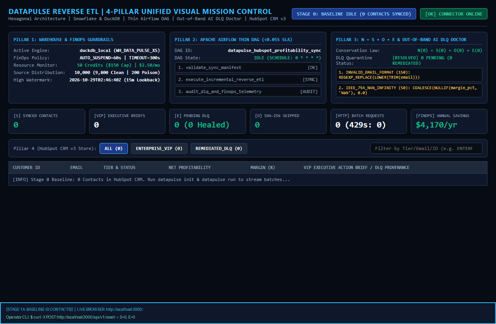
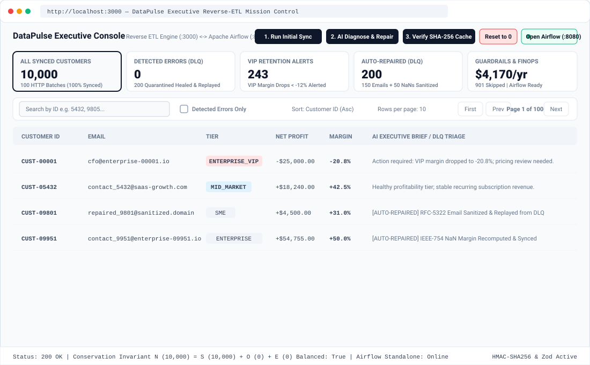
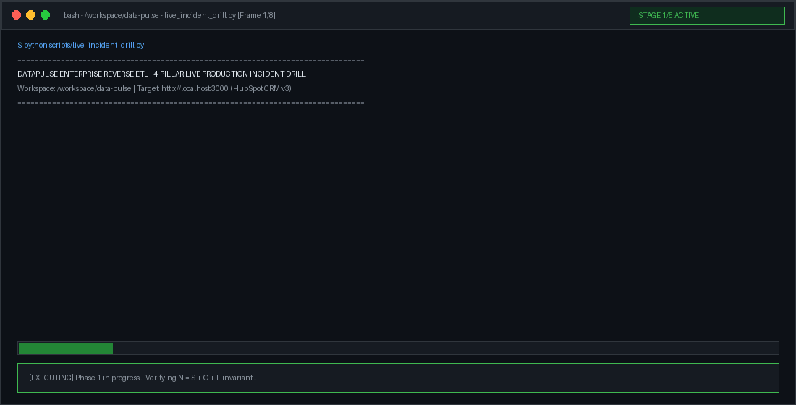
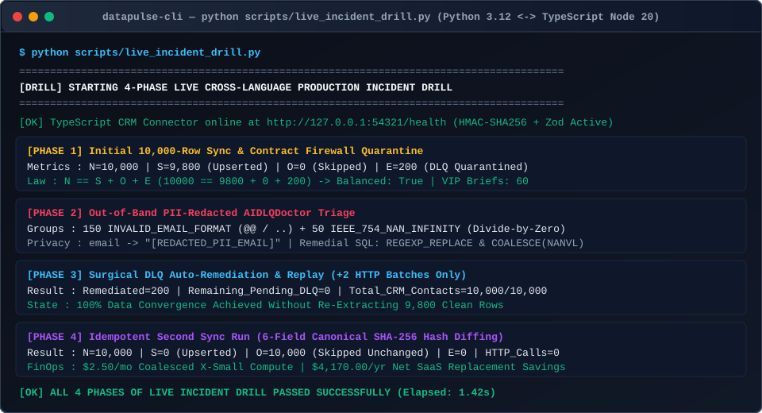
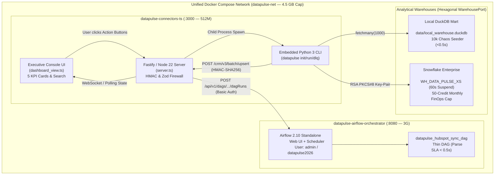
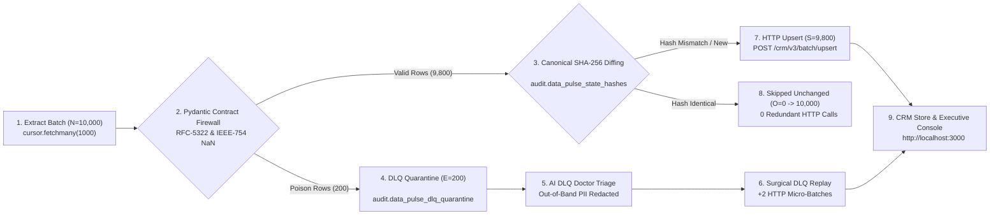

# DataPulse (`data-pulse`) — Self-Healing, FinOps-Governed Reverse-ETL Platform

[](./.github/workflows/ci-quality-gates.yml)
[](./pyproject.toml)
[](./connectors-ts/tsconfig.json)
[](./infra/snowflake/00_finops_guardrails.sql)
[](./orchestration/dags/datapulse_hubspot_sync_dag.py)
[](./LICENSE)
[](./pyproject.toml)

---

## The 60-Second Value Proposition

Commercial Reverse-ETL SaaS platforms (Census, Hightouch) bill upwards of **$4,200.00/yr** to sync analytical customer profitability records from cloud warehouses into business applications. When data anomalies occur (malformed emails, IEEE-754 `NaN` floats), traditional pipelines either crash entirely or halt downstream schedules. Furthermore, repeated full-sync schedules generate redundant HTTP calls that exhaust destination CRM rate limits.

**DataPulse (`data-pulse`)** is an enterprise-grade, polyglot Reverse-ETL platform engineered in **Python 3.12**, **TypeScript 5 / Node.js 22**, **DuckDB**, **Snowflake**, and **Apache Airflow 2.10**. It delivers:

1. **Unified Docker Compose Stack (`:3000` & `:8080`):** Multi-runtime container architecture coupling a light-mode Shadcn Executive Console on `http://localhost:3000` with out-of-the-box Apache Airflow 2.10 standalone on `http://localhost:8080` (`admin` / `datapulse2026`).
2. **Bidirectional REST Bridge:** 4 interactive console buttons execute Python engine CLI tasks inside Docker while simultaneously triggering live Airflow DAG runs via REST API.
3. **Mathematical Reconciliation Invariant ($N = S + O + E$):** Strictly accounts for every extracted row:
   $$\text{Extracted } (N) = \text{Upserted } (S) + \text{Skipped Unchanged } (O) + \text{Quarantined DLQ } (E)$$
4. **Canonical 6-Field SHA-256 State Diffing:** Bypasses unmodified database records in memory, eliminating redundant HTTP payloads (100% cache hit on steady-state runs).
5. **Out-of-Band PII-Redacted AI DLQ Doctor:** Analyzes quarantined errors outside the hot ingestion loop, generating deterministic SQL/regex auto-remediations.
6. **Surgical DLQ Replay:** Heals and flushes quarantined records over HTTP in minimal micro-batches, converging state from $200 \rightarrow 0$ pending DLQ records.
7. **FinOps Economics:** Operates on Snowflake `WH_DATA_PULSE_XS` for **~$2.50/mo** ($30.00/yr), yielding **$4,170.00/yr net operational savings** (99.3% TCO reduction).
8. **Dynamic Client Schema Adaptation:** Accepts arbitrary client tables with fewer or extra columns via Pydantic `ConfigDict(extra="allow")` and graceful fallback defaults.

---

## Visual Demo Showcase

### 1. Live Executive Console & FinOps Monitor (`http://localhost:3000`)



<details>
<summary>View High-DPI Vector Preview (<code>docs/assets/dashboard-preview.svg</code>)</summary>



</details>

### 2. Four-Phase Cross-Language Live Incident Drill (`python scripts/live_incident_drill.py`)



<details>
<summary>View High-DPI Vector Preview (<code>docs/assets/cli-drill-preview.svg</code>)</summary>



</details>

---

## End-to-End System Architecture

### 1. Container Topology & Bidirectional REST Bridge



### 2. Mathematical Reconciliation & Surgical DLQ Replay Data Flow



---

## FinOps Economics: `data-pulse` vs. Commercial SaaS

| FinOps Dimension | Commercial SaaS (Census / Hightouch) | DataPulse Reverse-ETL Platform | Quantitative FinOps Advantage |
| :--- | :--- | :--- | :--- |
| **Annual Software Licensing** | **$4,200.00 / year** ($350.00/mo base tier) | **$0.00 / year** (Open-Source Apache 2.0) | **$4,200.00 / yr saved** |
| **Warehouse Compute (Snowflake)** | Uncontrolled multi-slot query clustering | Bounded `X-SMALL` (1 credit/hr, 60s auto-suspend) | **~$2.50 / month** ($30.00/yr steady state) |
| **API Call Consumption** | Unoptimized full-table replication | 6-field canonical `SHA-256` digest cache | **0 redundant HTTP requests** on steady runs |
| **Local Simulation Infrastructure** | Requires live paid staging warehouses | Embedded in-process `DuckDB` | **$0.00** local simulation and CI testing cost |
| **Total Annual Operational TCO** | **$4,200.00+ / year** | **~$30.00 / year** | **$4,170.00 / yr net operational savings** |

---

## Operational Execution Modes

### Mode A / Mode 1: Unified Docker Compose Stack (Recommended 1-Command Startup)

Use **Mode 1:** when launching the complete enterprise ecosystem—Executive Console, CRM Mock Connector, Python Engine, and Apache Airflow 2.10—in a single command:

```bash
# 1. Build container images and launch the multi-service stack in detached mode
docker compose up -d --build

# 2. Inspect container status and verified memory governance
docker compose ps
docker stats --no-stream

# 3. Follow live streaming logs
docker compose logs -f connectors-ts airflow-orchestrator
```

#### 1. Live Executive Console (`http://localhost:3000`)
Open `http://localhost:3000` in your web browser. The console features:
- **The 4 Interactive Pipeline Action Buttons:**
  - **`1. Run Initial Sync`:** Executes initial extraction, streams 98 HTTP micro-batches to upsert 9,800 valid contacts, quarantines 200 poisoned records, and triggers an Airflow DAG run via REST API.
  - **`2. AI Diagnose & Repair`:** Runs the out-of-band AI DLQ Doctor to isolate root causes without exposing customer PII.
  - **`3. Verify SHA-256 Cache`:** Runs an idempotent pass over existing records, skipping 10,000 rows in memory with 0 HTTP calls.
  - **`Reset to 0`:** Purges DuckDB files and resets the CRM memory store to Stage 0 Honest Zero Baseline.
- **The 5 Interactive KPI Filter Cards:**
  - `All Synced Customers` (10,000 total)
  - `Detected Errors (DLQ)` (200 in quarantine -> 0 upon remediation)
  - `VIP Retention Alerts` (60 margin drops < -12.0%)
  - `Auto-Repaired (DLQ)` (200 healed rows)
  - `Guardrails & FinOps` ($4,170/yr saved | Airflow Ready)
- **Live Search & Server-Side Controls:**
  - Dynamic search input: query by customer ID (e.g., `5432`, `9805`) or email.
  - "Detected Errors Only" checkbox: filters table strictly to quarantined anomalies.
  - Bounded pagination controls (`First`, `Prev`, `Page 1 of 1000`, `Next`, `Last`) with customizable page sizes.
- **`Open Airflow (:8080)` Badge:** Displays live orchestrator status and links directly to Airflow.

#### 2. Apache Airflow 2.10 Standalone Console (`http://localhost:8080`)
Open `http://localhost:8080` in a new browser tab:
- **Username:** `admin`
- **Password:** `datapulse2026`
- **Active DAG:** `datapulse_hubspot_sync_dag` (pre-configured, unpaused, with parse SLA strictly `< 0.5s`).
- DAG runs triggered from the `:3000` Executive Console appear automatically in the Airflow Grid View with configuration `{"conf": {"triggered_by": "datapulse-mission-control-ui"}}`.

#### 3. Shutting Down Docker Cleanly
```bash
docker compose down
```

---

### Mode B / Mode 2: Local Host Development & CLI Walkthrough

Use **Mode 2:** for rapid local Python/TypeScript development or manual SRE incident drill practice without Docker.

#### Step 1: Prevent Port 3000 / 8080 Conflicts
Before starting local services on port 3000, ensure Docker and background Node instances are stopped:

```bash
docker compose stop
# Windows PowerShell port clearance:
Get-Process -Name node -ErrorAction SilentlyContinue | Stop-Process -Force
```

#### Step 2: Bootstrap Dependencies
```bash
# 1. Create Python virtual environment and install in editable mode
python -m venv .venv
# Windows: .\.venv\Scripts\Activate.ps1 | Linux/macOS: source .venv/bin/activate
pip install -e ".[dev]"

# 2. Install TypeScript CRM Connector dependencies
npm --prefix connectors-ts install
```

#### Step 3: Terminal 1 — Start Live TypeScript Connector (`:3000`)
```bash
npm --prefix connectors-ts start
```

#### Step 4: Terminal 2 — Execute Operator CLI Walkthrough (Steps A through E)
```bash
# Step A: Reset connector and seed 10,000 chaos records (9,800 clean, 150 bad email, 50 NaN)
curl -s -X POST http://localhost:3000/api/v1/reset
python -m datapulse.interfaces.cli init --rows 10000 --db-path data/local_warehouse.duckdb

# Step B: Run initial sync over live HTTP (9,800 synced in 98 batches, 200 quarantined to DLQ)
python -m datapulse.interfaces.cli run --manifest syncs/hubspot_profitability.yml --db-path data/local_warehouse.duckdb

# Step C: Inspect quarantined DLQ records via Out-of-Band AI Doctor
python -m datapulse.interfaces.cli dlq inspect --sync-id hubspot_customer_profitability --db-path data/local_warehouse.duckdb

# Step D: Execute surgical DLQ auto-remediation & replay (+2 HTTP batches -> 10,000/10,000 contacts, 0 pending)
python -m datapulse.interfaces.cli dlq replay --manifest syncs/hubspot_profitability.yml --db-path data/local_warehouse.duckdb

# Step E: Idempotent second sync run -> 10,000 skipped via SHA-256 hash diffing, 0 HTTP calls!
python -m datapulse.interfaces.cli run --manifest syncs/hubspot_profitability.yml --no-seed --db-path data/local_warehouse.duckdb
```

#### Step 5: Automated 1-Command Drill Script
Alternatively, run the complete cross-language chaos drill in under 5 seconds:

```bash
python scripts/live_incident_drill.py
```

---

### Mode C / Mode 3: Enterprise Production Cutover & Custom Client Databases

Use **Mode 3:** when transitioning from the local DuckDB simulation to live production warehouses (Snowflake, BigQuery, PostgreSQL) or integrating custom client schemas:

#### 1. Enforce Production Safeguards in `.env`
```ini
# Enforce production flags (locks out synthetic chaos seeding)
DEMO_SEED_ENABLED=false
SOURCE_ENGINE=snowflake
ENFORCE_HMAC=true
WEBHOOK_HMAC_SECRET=your-production-vault-secret-key-32b

# Snowflake Key-Pair Credentials
SNOWFLAKE_ACCOUNT=xy12345.us-east-1
SNOWFLAKE_USER=SVC_DATA_PULSE
SNOWFLAKE_PRIVATE_KEY_PATH=infra/keys/rsa_key.p8
SNOWFLAKE_DATABASE=ANALYTICS_PROD
SNOWFLAKE_SCHEMA=MARTS
SNOWFLAKE_WAREHOUSE=WH_DATA_PULSE_XS
```

#### 2. Execute Clean Production Sync (`--no-seed`)
```bash
# Initialize production schemas without generating synthetic rows
python -m datapulse.interfaces.cli init --no-seed

# Execute production reverse-ETL sync
python -m datapulse.interfaces.cli run --manifest syncs/hubspot_profitability.yml --no-seed
```

#### 3. Custom Client Database & Dynamic Schema Integration
DataPulse features schema-agnostic extraction. Client databases with arbitrary columns (e.g., 5,555 records, custom E-commerce metrics) are dynamically accepted by Pydantic v2 domain models using `model_config = ConfigDict(extra="allow", validate_default=True)`.

For step-by-step guidance on mapping custom tables to destination properties, consult [**Runbook 09: Custom Database & Schema Integration**](./docs/runbooks/09-custom-database-and-schema-integration.md).

---

## Clean Architecture Repository Map

```text
data-pulse/
|-- .antigravity/rules/                     # Engineering Standards & Clean Architecture Laws
|-- .github/workflows/ci-quality-gates.yml  # 4-Gate CI/CD Pipeline & Container Tagging
|-- core-engine/src/datapulse/              # Python 3.12 Reverse-ETL Core Engine
|   |-- domain/                             # Models, Ports, Value Objects & SHA-256 Hashing
|   |-- application/                        # SyncUseCase, DLQUseCase, Intelligence & FinOps
|   |-- infrastructure/                     # Snowflake, DuckDB, Seeder, HTTP Client & Alerts
|   +-- interfaces/                         # Universal 'datapulse' CLI (.env Auto-Loader)
|-- connectors-ts/                          # TypeScript 5 / Node 22 CRM Connector & UI
|   |-- src/domain/contracts.ts             # Runtime Zod Schemas & Contact Contracts
|   |-- src/application/resilience.ts       # Full-Jitter Backoff & Rate Limiter
|   +-- src/infrastructure/                 # Server (:3000), Executive Console & Airflow Bridge
|-- orchestration/dags/                     # Thin Apache Airflow 2.10 DAG (<0.5s Parse SLA)
|-- infra/
|   |-- docker/                             # Multi-runtime Dockerfiles (Node 22 + Python 3)
|   |-- snowflake/                          # FinOps Guardrails (00) & Zero-Trust RBAC (01)
|   +-- wsl/                                # WSL2 .wslconfig 6GB Memory Bounds
|-- syncs/hubspot_profitability.yml         # Declarative Reverse-ETL Topology Manifest
+-- docs/                                   # 9 ADRs + 10 Operational Runbooks + Architecture
```

---

## Complete Documentation Index

All architectural specifications, decision records, and operational procedures are indexed in the [**DataPulse Enterprise Documentation Portal (`docs/INDEX.md`)**](./docs/INDEX.md).

### Architecture Decision Records (`docs/adr/ADR-000` to `ADR-008`)

| ADR ID | Decision Record Document | Architectural Decision & Quantitative Metric |
| :--- | :--- | :--- |
| **ADR-000** | [ADR-000-local-container-resource-governance.md](./docs/adr/ADR-000-local-container-resource-governance.md) | Caps WSL2 at `6GB` RAM / `4` vCPUs and Docker stack at `4.5GB` total RAM. |
| **ADR-001** | [ADR-001-snowflake-finops-and-zero-trust-rbac.md](./docs/adr/ADR-001-snowflake-finops-and-zero-trust-rbac.md) | Enforces `WH_DATA_PULSE_XS` (60s suspend), 50-credit ceiling, and RSA-2048 RBAC. |
| **ADR-002** | [ADR-002-declarative-yaml-manifests-and-pydantic-contracts.md](./docs/adr/ADR-002-declarative-yaml-manifests-and-pydantic-contracts.md) | Declarative YAML topology paired with row-level Pydantic v2 `NaN`/RFC email validation. |
| **ADR-003** | [ADR-003-dual-warehouse-adapter-and-deterministic-seeding.md](./docs/adr/ADR-003-dual-warehouse-adapter-and-deterministic-seeding.md) | Hexagonal `WarehousePort` with interchangeable `DuckDB` and `Snowflake` adapters. |
| **ADR-004** | [ADR-004-out-of-band-ai-triage-and-payload-hash-diffing.md](./docs/adr/ADR-004-out-of-band-ai-triage-and-payload-hash-diffing.md) | Canonical 6-field `SHA-256` diffing (0 HTTP calls), $N = S + O + E$, and `AIDLQDoctor`. |
| **ADR-005** | [ADR-005-typescript-zod-connector-and-full-jitter-backoff.md](./docs/adr/ADR-005-typescript-zod-connector-and-full-jitter-backoff.md) | Runtime Zod contracts, timing-safe `HMAC-SHA256`, 5MB body limit, and Full-Jitter backoff. |
| **ADR-006** | [ADR-006-thin-airflow-dags-and-cli-decoupling.md](./docs/adr/ADR-006-thin-airflow-dags-and-cli-decoupling.md) | Decouples Airflow scheduling (`<0.5s` parse SLA) from execution via the Universal CLI. |
| **ADR-007** | [ADR-007-surgical-dlq-replay-and-idempotent-recovery.md](./docs/adr/ADR-007-surgical-dlq-replay-and-idempotent-recovery.md) | Surgical DLQ replay (`200 -> 0` pending in 2 HTTP batches) and `--no-seed` cutover locks. |
| **ADR-008** | [ADR-008-four-gate-cicd-and-immutable-container-tags.md](./docs/adr/ADR-008-four-gate-cicd-and-immutable-container-tags.md) | 4-Gate CI/CD pipeline and non-root multi-stage Docker builds (`:latest` + `:sha-<commit>`). |

### Enterprise Operational Runbooks (`docs/runbooks/00` to `09`)

| Runbook | Operational Runbook Document | Primary Engineering Scope |
| :--- | :--- | :--- |
| **Runbook 00** | [00-host-hardware-and-wsl2-setup.md](./docs/runbooks/00-host-hardware-and-wsl2-setup.md) | Pre-flight hardware audit (`preflight_hardware_audit.py`), `.wslconfig`, and VHDX compaction. |
| **Runbook 01** | [01-snowflake-finops-and-rbac-provisioning.md](./docs/runbooks/01-snowflake-finops-and-rbac-provisioning.md) | PKCS#8 RSA-2048 key generation, FinOps & RBAC DDL, and verification SQL queries. |
| **Runbook 02** | [02-declarative-sync-manifests-and-data-contracts.md](./docs/runbooks/02-declarative-sync-manifests-and-data-contracts.md) | Annotated `hubspot_profitability.yml`, `datapulse validate`, and `SHA-256` hashing. |
| **Runbook 03** | [03-local-duckdb-simulation-and-incremental-watermarks.md](./docs/runbooks/03-local-duckdb-simulation-and-incremental-watermarks.md) | `datapulse init --rows 10000`, 5 DuckDB verification queries, and lookback windows. |
| **Runbook 04** | [04-resilience-engine-finops-and-dlq-doctor.md](./docs/runbooks/04-resilience-engine-finops-and-dlq-doctor.md) | Telemetry analysis, FinOps math (`$4,170/yr` savings), and `datapulse dlq inspect`. |
| **Runbook 05** | [05-typescript-crm-connector-and-live-dashboard.md](./docs/runbooks/05-typescript-crm-connector-and-live-dashboard.md) | 5 KPI cards, 4 action buttons, `Open Airflow (:8080)`, HMAC security, and `/api/v1/contacts`. |
| **Runbook 06** | [06-cli-airflow-and-docker-orchestration.md](./docs/runbooks/06-cli-airflow-and-docker-orchestration.md) | 3-service Docker stack, Airflow 2.10 standalone (`admin` / `datapulse2026`), and REST bridge. |
| **Runbook 07** | [07-live-production-incident-drill-and-production-cutover.md](./docs/runbooks/07-live-production-incident-drill-and-production-cutover.md) | **Mode A** (Docker buttons), **Mode B** (2-terminal walkthrough), and **Mode C** (Production Cutover). |
| **Runbook 08** | [08-cicd-quality-gates-and-dockerhub-publishing.md](./docs/runbooks/08-cicd-quality-gates-and-dockerhub-publishing.md) | Local 4-Gate pre-push script, standalone `docker run` networking, and `:sha-<commit>` rollbacks. |
| **Runbook 09** | [09-custom-database-and-schema-integration.md](./docs/runbooks/09-custom-database-and-schema-integration.md) | Integrating arbitrary schemas (5,555 records, E-commerce/SaaS models) and cloud cutover. |

---

## License & Author

- **Author:** Darwin Miguel Abarca Vargas
- **License:** Licensed under the [Apache License, Version 2.0](./LICENSE).
