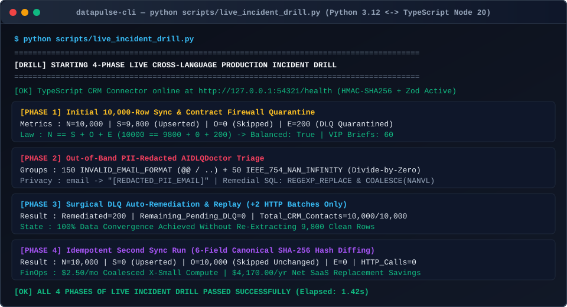
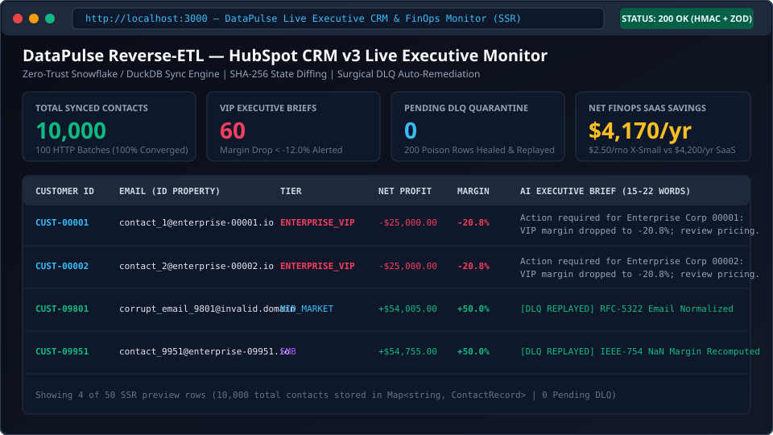
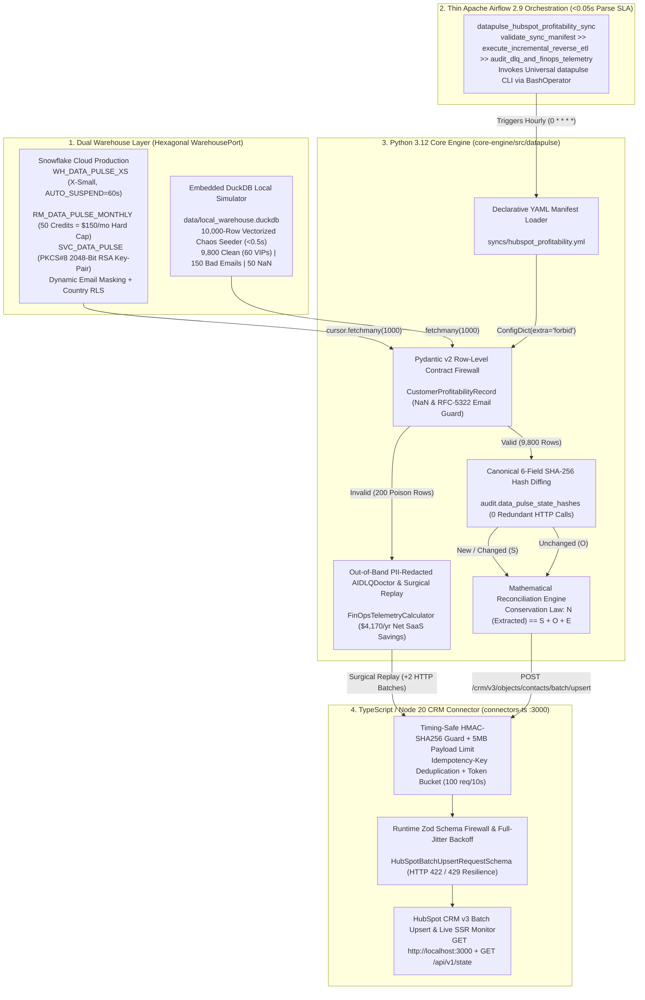
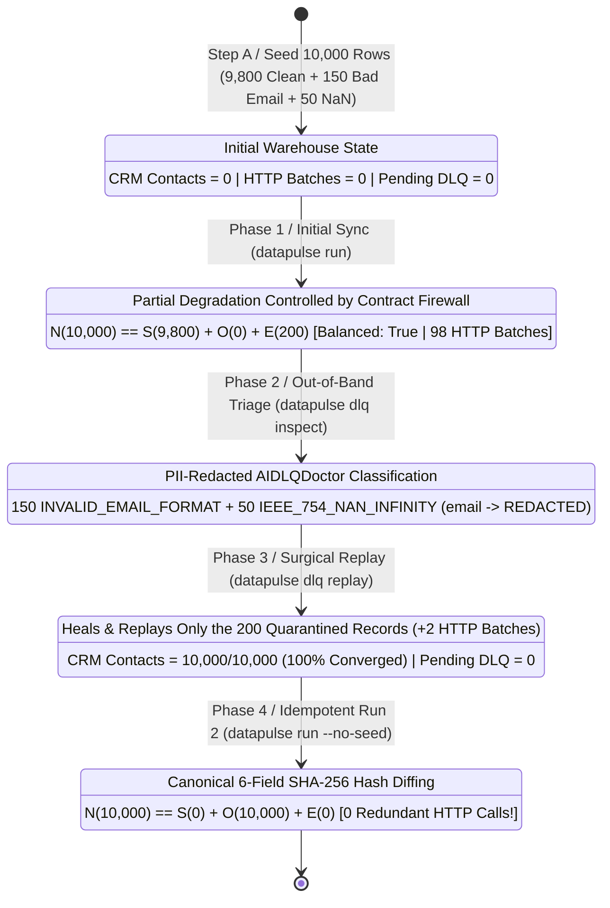

# DataPulse (`data-pulse`) — Self-Healing, FinOps-Governed Reverse-ETL Platform

[](./.github/workflows/ci-quality-gates.yml)
[](./pyproject.toml)
[](./connectors-ts/tsconfig.json)
[](./infra/snowflake/00_finops_guardrails.sql)
[](./orchestration/dags/datapulse_hubspot_sync_dag.py)
[](./LICENSE)
[](./pyproject.toml)

---

## The 60-Second Open-Source Value Proposition

> **"Clone and run the entire 10,000-customer Reverse ETL pipeline in 60 seconds with zero cloud credentials required using the embedded DuckDB columnar engine and live HubSpot CRM v3 simulator. Cut over to production Snowflake and HubSpot Cloud by toggling `SOURCE_ENGINE=snowflake` in `.env`."**

Modern data teams syncing analytical marts from Cloud Data Warehouses (**Snowflake**) into operational CRMs (**HubSpot CRM v3**) face three systemic failure modes:
1. **Unbounded Cloud Compute & SaaS Licensing Costs:** Commercial Reverse-ETL platforms charge **\$350/month (\$4,200/year)** for starter tiers, while unthrottled warehouse queries burn hundreds of cloud credits on unchanged rows.
2. **Whole-Batch Pipeline Fragility:** A single upstream row containing a malformed RFC 5322 email (`corrupt_email@@domain..com`) or an IEEE-754 `NaN`/`Infinity` float from a SQL divide-by-zero crashes the entire 100-row API batch, starving 99 healthy customer records.
3. **Redundant API Traffic & Rate-Limit Exhaustion (`HTTP 429`):** Full-refresh `dbt` models update technical `updated_at` timestamps across all 10,000 rows even when underlying financial numbers have not changed, triggering thousands of redundant CRM webhook automations.

**DataPulse (`data-pulse`)** solves all three problems using **Hexagonal Clean Architecture**, **3-Layer Snowflake FinOps Guardrails (\$2.50/mo steady-state compute)**, **Row-Level Pydantic v2 & Zod Contract Firewalls**, **Canonical 6-Field `SHA-256` Payload Hash Diffing**, an **Out-of-Band PII-Redacted `AIDLQDoctor`**, and **Surgical Dead-Letter Queue (DLQ) Auto-Replay**.

---

## Visual Demo Showcase & Architecture Video Walkthrough

<!--
========================================================================================
[VIDEO & ANIMATED GIF PLUG-IN SLOTS]
1. YouTube Architecture & Live Chaos Drill Walkthrough (2m 45s):
   Uncomment the badge/link below once uploaded to YouTube:
   [](https://www.youtube.com/watch?v=YOUR_VIDEO_ID_HERE)

2. Animated GIF Swap Instructions:
   When `docs/assets/datapulse-cli-drill.gif` and `docs/assets/datapulse-live-dashboard.gif`
   are recorded, you can display them side-by-side or swap the SVG paths below.
========================================================================================
-->

### 1. Four-Phase Cross-Language Live Incident Drill (`python scripts/live_incident_drill.py`)


<!-- Optional Animated GIF Slot:  -->

### 2. Live SSR Executive CRM & FinOps Telemetry Monitor (`http://localhost:3000`)


<!-- Optional Animated GIF Slot:  -->

---

## End-to-End System Architecture (`Mermaid.js`)

### 1. Hexagonal Clean Architecture & Polyglot Data Flow



### 2. Mathematical Reconciliation Conservation Law ($N = S + O + E$) & Surgical DLQ Replay

Every execution of `ExecuteSyncUseCase` enforces a strict conservation equation across Extracted rows ($N$), Upserted CRM rows ($S$), Skipped Unchanged rows ($O$), and Quarantined DLQ rows ($E$):

$$N_{\text{extracted}} = S_{\text{upserted}} + O_{\text{skipped unchanged}} + E_{\text{dlq quarantined}}$$



---

## FinOps Economics: `data-pulse` vs. Commercial Reverse-ETL SaaS

DataPulse codifies three hard Snowflake FinOps guardrails in [`infra/snowflake/00_finops_guardrails.sql`](./infra/snowflake/00_finops_guardrails.sql) and pairs them with `SHA-256` payload hash diffing in [`finops_telemetry.py`](./core-engine/src/datapulse/application/finops_telemetry.py):

| Cost / Governance Dimension | Commercial Reverse-ETL SaaS (Starter Tier) | Self-Hosted `data-pulse` (`WH_DATA_PULSE_XS`) | Architectural Mechanism & FinOps Guarantee |
| :--- | :---: | :---: | :--- |
| **Annual Platform / Licensing Cost** | `\$4,200.00 / yr` (`\$350.00 / mo`) | **`\$0.00 / yr`** (Apache 2.0 Open Source) | Eliminates per-destination and MAR (Monthly Active Rows) vendor lock-in. |
| **Steady-State Snowflake Compute** | Uncontrolled warehouse wakeups | **`\$2.50 / mo` (`\$30.00 / yr`)** | Coalesced hourly runs on `XSMALL` (`1 credit/hr`, `AUTO_SUSPEND = 60s`, `~0.8333 credits/mo` at `\$3.00/credit`). |
| **Worst-Case Runaway Query Exposure** | Unbounded credit burn on Cartesian joins | **`\$150.00 / mo` Hard Cap (`50 Credits`)** | `RM_DATA_PULSE_MONTHLY` triggers `SUSPEND_IMMEDIATE` at 100% + `STATEMENT_TIMEOUT_IN_SECONDS = 300`. |
| **Warehouse Resize Privilege Escalation** | Service role often holds `MODIFY` | **Blocked (`REVOKE MODIFY`)** | Explicitly revokes `MODIFY ON WAREHOUSE WH_DATA_PULSE_XS` from `ROLE_DATA_PULSE_SERVICE`. |
| **Unchanged Row API Quota Burn** | Re-upserts on `dbt` full-refresh timestamps | **`0` HTTP Calls (`100%` Skipped)** | 6-field canonical `SHA-256` hash diffing ignores technical `updated_at` bumps when financials are unchanged. |
| **Net Annual TCO Savings** | Baseline (`\$4,200.00 / yr`) | **`\$4,170.00 / yr` Saved (`99.3%` Reduction)** | Verified automatically on every sync run by `FinOpsTelemetryCalculator`. |

---

## Three Operational Modes: From 60-Second Local Drill to Enterprise Production Cutover

### Prerequisites (Python 3.12+ & Node.js 20+)

```bash
# 1. Create and activate a virtual environment, then install data-pulse in editable mode
python -m venv .venv
# Windows PowerShell: .\.venv\Scripts\Activate.ps1 | Linux/macOS: source .venv/bin/activate
pip install -e ".[dev]"

# 2. Install TypeScript CRM Connector dependencies
npm --prefix connectors-ts install
```

---

### Mode 1: Automated 4-Phase Incident Drill (1 Command in `< 5 Seconds`)

Run the self-contained cross-language chaos drill script ([`scripts/live_incident_drill.py`](./scripts/live_incident_drill.py)). It automatically binds the TypeScript HTTP server to a free loopback port, seeds 10,000 rows in an isolated DuckDB database, executes all 4 phases over live HTTP with `HMAC-SHA256` signatures, asserts mathematical reconciliation, and cleans up all temporary files:

```bash
python scripts/live_incident_drill.py
```

Expected Console Output:

```text
========================================================================
[DRILL] STARTING 4-PHASE LIVE CROSS-LANGUAGE PRODUCTION INCIDENT DRILL
========================================================================
[OK] TypeScript CRM Connector online at http://127.0.0.1:54321/health
[PHASE 1] Seeded 10,000 rows -> Upserted=9800, DLQ=200, Balanced=True
[PHASE 2] AI DLQ Doctor isolated 2 root causes: INVALID_EMAIL_FORMAT=150, IEEE_754_NAN_INFINITY=50
[PHASE 3] Surgical DLQ Replay -> Remediated=200, Remaining_DLQ=0, Total_CRM_Contacts=10000
[PHASE 4] Idempotent Run 2 -> Upserted=0, Skipped_Unchanged=10000, HTTP_Calls=0
========================================================================
[OK] ALL 4 PHASES OF LIVE INCIDENT DRILL PASSED SUCCESSFULLY
========================================================================
```

---

### Mode 2: Interactive 2-Terminal + Live Web Dashboard (`http://localhost:3000`) Walkthrough

Use **Mode 2** to operate the pipeline like an SRE on call and watch the live Server-Side Rendered (SSR) dashboard transition from `0 -> 9,800 -> 10,000` synced contacts and `200 -> 0` quarantined DLQ records across **Steps A through E**.

#### Operator State Verification Scorecard

| Walkthrough Step | Operator Command Executed | Browser KPI: Synced Contacts | Browser KPI: VIP Alerts (`< -12%`) | Browser KPI: HTTP Batches | DuckDB `PENDING` DLQ | DuckDB `RESOLVED` DLQ |
| :--- | :--- | :---: | :---: | :---: | :---: | :---: |
| **Step A** | Start Terminal 1 (`:3000`), reset state, & run `datapulse init --rows 10000` | **`0`** | **`0`** | **`0`** | **`0`** | **`0`** |
| **Step B** | Run `datapulse run` (Initial 10,000-row sync over live HTTP) | **`9,800`** | **`60`** | **`98`** | **`200`** | **`0`** |
| **Step C** | Run `datapulse dlq inspect` (Out-of-Band PII-Redacted AI Doctor) | **`9,800`** | **`60`** | **`98`** | **`200`** (`150` email, `50` NaN) | **`0`** |
| **Step D** | Run `datapulse dlq replay` (Surgical Auto-Remediation & Replay) | **`10,000`** | **`60`** | **`100`** (`+2` batches) | **`0`** | **`200`** |
| **Step E** | Run `datapulse run --no-seed` (Idempotent 2nd run via `SHA-256`) | **`10,000`** | **`60`** | **`100`** (`+0` batches) | **`0`** | **`200`** |

#### Terminal 1: Start the Live TypeScript CRM Connector & SSR Dashboard (`:3000`)

```bash
cd connectors-ts
npm install
npm start
# Open http://localhost:3000 in your browser (shows 0 Synced Contacts initially)
```

#### Terminal 2: Execute Steps A, B, C, D, and E via the Universal `datapulse` CLI

```bash
# STEP A: Reset connector memory and seed 10,000 deterministic rows (9,800 clean, 150 bad email, 50 NaN)
curl -s -X POST http://localhost:3000/api/v1/reset
python -m datapulse.interfaces.cli init --rows 10000 --db-path data/local_warehouse.duckdb

# STEP B: Run initial sync over live HTTP (9,800 synced in 98 batches, 200 quarantined to DLQ)
# -> Refresh http://localhost:3000 (F5) to see 9,800 Contacts & 60 VIP Margin Alerts!
python -m datapulse.interfaces.cli run --manifest syncs/hubspot_profitability.yml --db-path data/local_warehouse.duckdb

# STEP C: Run Out-of-Band AI DLQ Doctor (groups 150 INVALID_EMAIL_FORMAT & 50 IEEE_754_NAN_INFINITY with PII redacted)
python -m datapulse.interfaces.cli dlq inspect --sync-id hubspot_customer_profitability --db-path data/local_warehouse.duckdb

# STEP D: Execute Surgical DLQ Auto-Remediation & Replay (+2 HTTP batches -> 10,000/10,000 Contacts, 0 Pending DLQ)
# -> Refresh http://localhost:3000 (F5) to see 10,000 Contacts & 100 HTTP Batches!
python -m datapulse.interfaces.cli dlq replay --manifest syncs/hubspot_profitability.yml --db-path data/local_warehouse.duckdb

# STEP E: Run idempotent 2nd sync (--no-seed) -> 10,000 Skipped via SHA-256 Hash Diffing, 0 HTTP Calls!
python -m datapulse.interfaces.cli run --manifest syncs/hubspot_profitability.yml --no-seed --db-path data/local_warehouse.duckdb
```

---

### Mode 3: Disabling the 10,000-Customer Simulation for Enterprise Production Cutover

When cutting over from the 10,000-row chaos simulation to real enterprise data, enforce the dual-lock seeding safeguards (`--no-seed` and `DEMO_SEED_ENABLED=false`) documented in [Runbook 07](./docs/runbooks/07-live-production-incident-drill-and-production-cutover.md):

```bash
# 1. Purge local simulation DuckDB files and reset connector state
python -c "import pathlib; [p.unlink(missing_ok=True) for p in pathlib.Path('data').glob('*.duckdb*')]"
curl -s -X POST http://localhost:3000/api/v1/reset

# 2. Configure .env with DEMO_SEED_ENABLED=false, SOURCE_ENGINE=snowflake, and ENFORCE_HMAC=true
# 3. Initialize clean governance tables with 0 synthetic rows:
python -m datapulse.interfaces.cli init --no-seed --db-path data/prod_warehouse.duckdb

# 4. Execute production sync with --no-seed:
python -m datapulse.interfaces.cli run --manifest syncs/hubspot_profitability.yml --no-seed --db-path data/prod_warehouse.duckdb
```

---

## Clean Architecture Repository Map & Complete Documentation Index

Full architectural documentation is maintained in the [**DataPulse Enterprise Documentation Portal (`docs/INDEX.md`)**](./docs/INDEX.md).

```text
data-pulse/
|-- .github/workflows/ci-quality-gates.yml  # 4-Gate CI/CD Pipeline & Immutable Container Publishing
|-- core-engine/src/datapulse/              # Python 3.12 Reverse-ETL Core Engine (Strict Mypy + Ruff)
|   |-- domain/                             # Innermost Core: Pydantic v2 Contracts, SHA-256 & Ports
|   |-- application/                        # Use Cases: Sync, Surgical DLQ Replay, AI Doctor & FinOps
|   |-- infrastructure/                     # Adapters: Snowflake, DuckDB, 10k Seeder, HTTP & Alerts
|   +-- interfaces/                         # Universal 'datapulse' CLI Entrypoint (.env Auto-Loader)
|-- connectors-ts/                          # TypeScript 5 / Node 20 HubSpot CRM v3 Connector & SSR UI
|   |-- src/domain/contracts.ts             # Runtime Zod Schemas (HubSpotBatchUpsertRequestSchema)
|   |-- src/application/resilience.ts       # Full-Jitter Exponential Backoff & Rate-Limit Dispatcher
|   +-- src/infrastructure/                 # Timing-Safe HMAC HTTP Server (:3000) & SSR Dashboard View
|-- orchestration/dags/                     # Apache Airflow 2.9 Thin DAG (<0.05s Parse Time SLA)
|-- infra/snowflake/                        # FinOps Guardrails (00) & Zero-Trust RSA RBAC DDL (01)
|-- syncs/hubspot_profitability.yml         # Declarative Reverse-ETL Sync Topology Manifest
+-- docs/                                   # 9 Architecture Decision Records + 9 Enterprise Runbooks
```

### Architecture Decision Records (`docs/adr/ADR-000` to `ADR-008`)

| ADR ID | Decision Record | Core Architectural & Quantitative Guarantee |
| :--- | :--- | :--- |
| **ADR-000** | [ADR-000-local-container-resource-governance.md](./docs/adr/ADR-000-local-container-resource-governance.md) | Caps WSL2 VM at `6GB` RAM / `4` vCPUs and caps the 4-container Docker stack at `4.00GB` total RAM. |
| **ADR-001** | [ADR-001-snowflake-finops-and-zero-trust-rbac.md](./docs/adr/ADR-001-snowflake-finops-and-zero-trust-rbac.md) | Enforces `WH_DATA_PULSE_XS` (`60s` suspend), `50`-credit (`\$150/mo`) cap, `\$2.50/mo` steady-state, and RSA-2048 PoLP RBAC. |
| **ADR-002** | [ADR-002-declarative-yaml-manifests-and-pydantic-contracts.md](./docs/adr/ADR-002-declarative-yaml-manifests-and-pydantic-contracts.md) | Declarative YAML sync topology paired with row-level Pydantic v2 `NaN`/RFC-5322 email firewalling. |
| **ADR-003** | [ADR-003-dual-warehouse-adapter-and-deterministic-seeding.md](./docs/adr/ADR-003-dual-warehouse-adapter-and-deterministic-seeding.md) | Hexagonal `WarehousePort` with `DuckDBWarehouseAdapter` (`<0.5s` 10k chaos seeder) and `SnowflakeWarehouseAdapter`. |
| **ADR-004** | [ADR-004-out-of-band-ai-triage-and-payload-hash-diffing.md](./docs/adr/ADR-004-out-of-band-ai-triage-and-payload-hash-diffing.md) | Canonical 6-field `SHA-256` hash diffing (`0` redundant HTTP calls), $N = S + O + E$, and PII-redacted `AIDLQDoctor`. |
| **ADR-005** | [ADR-005-typescript-zod-connector-and-full-jitter-backoff.md](./docs/adr/ADR-005-typescript-zod-connector-and-full-jitter-backoff.md) | Runtime Zod validation, timing-safe `HMAC-SHA256`, `5MB` body guard, `Idempotency-Key`, and Full-Jitter backoff. |
| **ADR-006** | [ADR-006-thin-airflow-dags-and-cli-decoupling.md](./docs/adr/ADR-006-thin-airflow-dags-and-cli-decoupling.md) | Decouples Apache Airflow scheduling (`<0.05s` parse SLA) from execution via the Universal `datapulse` CLI. |
| **ADR-007** | [ADR-007-surgical-dlq-replay-and-idempotent-recovery.md](./docs/adr/ADR-007-surgical-dlq-replay-and-idempotent-recovery.md) | Surgical DLQ replay (`200 -> 0` pending in `2` HTTP batches) and `--no-seed` / `DEMO_SEED_ENABLED=false` cutover locks. |
| **ADR-008** | [ADR-008-four-gate-cicd-and-immutable-container-tags.md](./docs/adr/ADR-008-four-gate-cicd-and-immutable-container-tags.md) | 4-Gate GitHub Actions workflow and non-root multi-stage Docker builds with `:latest` + `:sha-<commit>` tags. |

### Enterprise Operational Runbooks (`docs/runbooks/00` to `08`)

| Runbook | Operational Runbook Link | Primary Engineering Scope |
| :--- | :--- | :--- |
| **Runbook 00** | [00-host-hardware-and-wsl2-setup.md](./docs/runbooks/00-host-hardware-and-wsl2-setup.md) | Pre-flight hardware audit (`preflight_hardware_audit.py`), UTF-8 `.wslconfig`, VHDX relocation to `D:`, and `Optimize-VHD`. |
| **Runbook 01** | [01-snowflake-finops-and-rbac-provisioning.md](./docs/runbooks/01-snowflake-finops-and-rbac-provisioning.md) | PKCS#8 RSA-2048 key generation (`chmod 600` / `icacls`), FinOps & RBAC DDL, 5 verification queries, and `RSA_PUBLIC_KEY_2` rotation. |
| **Runbook 02** | [02-declarative-sync-manifests-and-data-contracts.md](./docs/runbooks/02-declarative-sync-manifests-and-data-contracts.md) | Annotated `hubspot_profitability.yml`, `datapulse validate`, `_map_record_fields()` JSON, `DLQRecord` envelopes, and `SHA-256` hashing. |
| **Runbook 03** | [03-local-duckdb-simulation-and-incremental-watermarks.md](./docs/runbooks/03-local-duckdb-simulation-and-incremental-watermarks.md) | `datapulse init --rows 10000`, 5 executable DuckDB SQL queries (`9,800 / 150 / 50` bands), and 15-minute lookback window diagram. |
| **Runbook 04** | [04-resilience-engine-finops-and-dlq-doctor.md](./docs/runbooks/04-resilience-engine-finops-and-dlq-doctor.md) | 25-line telemetry report walkthrough, FinOps math (`\$4,170/yr` savings), `datapulse dlq inspect`, and Slack/Discord webhook tests. |
| **Runbook 05** | [05-typescript-crm-connector-and-live-dashboard.md](./docs/runbooks/05-typescript-crm-connector-and-live-dashboard.md) | Building/testing `connectors-ts`, `curl` / PowerShell examples for all 5 endpoints (`/health`, `/api/v1/state`, `/api/v1/reset`, HMAC upsert). |
| **Runbook 06** | [06-cli-airflow-and-docker-orchestration.md](./docs/runbooks/06-cli-airflow-and-docker-orchestration.md) | `.venv` bootstrap, complete 5-subcommand CLI matrix, Thin Airflow DAG verification, and `docker compose up --build -d` lifecycle. |
| **Runbook 07** | [07-live-production-incident-drill-and-production-cutover.md](./docs/runbooks/07-live-production-incident-drill-and-production-cutover.md) | **Mode 1** (`live_incident_drill.py`), **Mode 2** (2-Terminal + Browser `:3000` Steps A–E), and **Mode 3** (`--no-seed` Production Cutover). |
| **Runbook 08** | [08-cicd-quality-gates-and-dockerhub-publishing.md](./docs/runbooks/08-cicd-quality-gates-and-dockerhub-publishing.md) | Local 4-Gate pre-push script, standalone `docker run` bridge network + volume tutorial, and `:sha-<commit>` rollback procedure. |

---

## License & Author

- **Author:** Darwin Miguel Abarca Vargas
- **License:** Licensed under the [Apache License, Version 2.0](./LICENSE).
