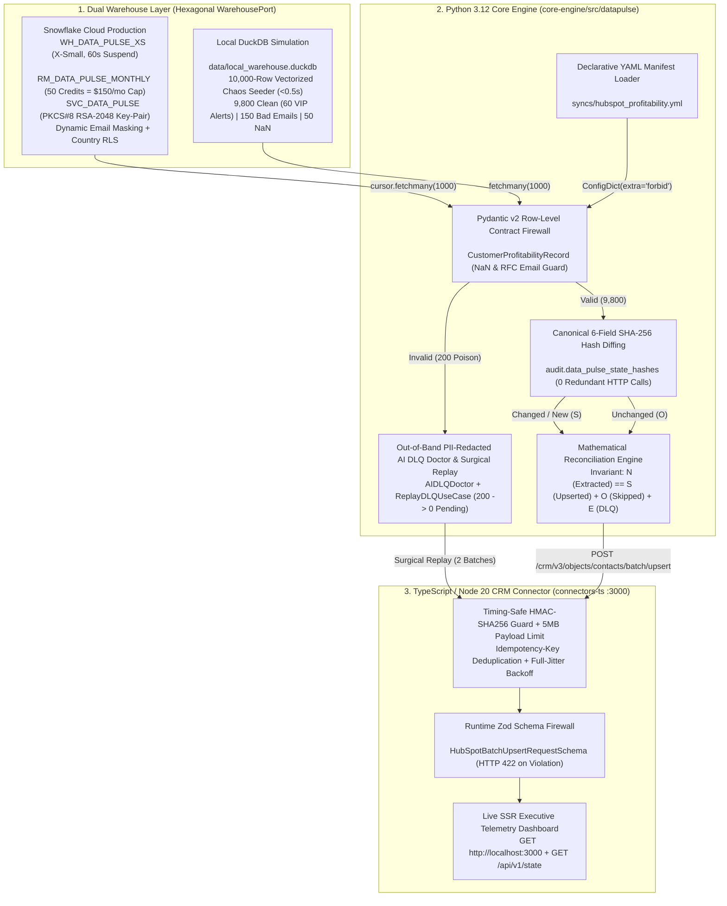

# DataPulse Enterprise Documentation Portal (`docs/INDEX.md`)

Welcome to the central architectural and operational documentation index for **DataPulse (`data-pulse`)** — a self-healing, FinOps-governed Reverse-ETL platform engineered in Python 3.12, TypeScript 5 / Node.js 20, Snowflake Cloud Data Warehouse, DuckDB, and Apache Airflow 2.9.

---

## 1. End-to-End Platform Architecture & Data Flow



---

## 2. Clean Architecture Layer Dependency Matrix

All source modules across `core-engine/` and `connectors-ts/` strictly enforce the inward-pointing **Clean Architecture Dependency Rule**:

| Architectural Layer | Python Package (`core-engine/src/datapulse/`) | TypeScript Package (`connectors-ts/src/`) | Permitted Imports | Forbidden Imports |
| :--- | :--- | :--- | :--- | :--- |
| **1. Domain (Innermost Core)** | `domain/models.py`<br>`domain/ports.py` | `domain/contracts.ts` | Standard library, `pydantic`, `zod` | Never imports `application`, `infrastructure`, `interfaces`, `duckdb`, `snowflake`, or `http`. |
| **2. Application (Use Cases)** | `application/sync_use_case.py`<br>`application/dlq_use_case.py`<br>`application/intelligence.py`<br>`application/finops_telemetry.py` | `application/resilience.ts` | `domain.*`, standard library | Never imports concrete adapters (`duckdb_adapter`, `snowflake_adapter`, `server.ts`, `cli.py`). |
| **3. Infrastructure (Adapters)** | `infrastructure/duckdb_adapter.py`<br>`infrastructure/snowflake_adapter.py`<br>`infrastructure/http_connector_client.py`<br>`infrastructure/alert_dispatcher.py`<br>`infrastructure/manifest_loader.py`<br>`infrastructure/seeder.py` | `infrastructure/server.ts`<br>`infrastructure/dashboard_view.ts` | `domain.*`, `application.*`, third-party SDKs (`duckdb`, `snowflake-connector-python`, `yaml`, `node:http`) | Never imported by `domain` or `application`. |
| **4. Interfaces & Orchestration** | `interfaces/cli.py`<br>`orchestration/dags/datapulse_hubspot_sync_dag.py` | CLI / HTTP Server Entrypoint | Wires `infrastructure` adapters into `application` use cases | Thin Airflow DAG imports zero `datapulse.*` modules directly (invokes CLI via `BashOperator`). |

---

## 3. Architecture Decision Records (`docs/adr/ADR-000` through `ADR-008`)

Every ADR follows Michael Nygard's format (`Status`, `Context`, `Decision`, `Consequences`), documents rejected alternatives and concrete FinOps metrics, and is strictly bounded to `20–30` lines:

| ADR ID | Document Link | Architectural Decision & Core Quantitative Guarantee |
| :--- | :--- | :--- |
| **ADR-000** | [ADR-000-local-container-resource-governance.md](adr/ADR-000-local-container-resource-governance.md) | Caps WSL2 VM at `6GB` RAM / `4` vCPUs via `.wslconfig` and caps the 4-container Docker Compose stack at `4.25GB` total RAM. |
| **ADR-001** | [ADR-001-snowflake-finops-and-zero-trust-rbac.md](adr/ADR-001-snowflake-finops-and-zero-trust-rbac.md) | Enforces `WH_DATA_PULSE_XS` (`60s` auto-suspend), `50`-credit (`$150/mo`) hard ceiling, `$2.50/mo` steady-state (`$4,170/yr` savings), and PKCS#8 RSA PoLP RBAC. |
| **ADR-002** | [ADR-002-declarative-yaml-manifests-and-pydantic-contracts.md](adr/ADR-002-declarative-yaml-manifests-and-pydantic-contracts.md) | Decouples sync topology into declarative YAML (`syncs/hubspot_profitability.yml`) paired with row-level Pydantic v2 `NaN`/RFC-email firewalling. |
| **ADR-003** | [ADR-003-dual-warehouse-adapter-and-deterministic-seeding.md](adr/ADR-003-dual-warehouse-adapter-and-deterministic-seeding.md) | Implements `WarehousePort` with interchangeable `DuckDBWarehouseAdapter` (10k vectorized chaos seeder in `<0.5s`) and `SnowflakeWarehouseAdapter`. |
| **ADR-004** | [ADR-004-out-of-band-ai-triage-and-payload-hash-diffing.md](adr/ADR-004-out-of-band-ai-triage-and-payload-hash-diffing.md) | Enforces canonical 6-field `SHA-256` payload hash diffing (`0` HTTP calls on unchanged runs), $N = S + O + E$, and PII-redacted `AIDLQDoctor`. |
| **ADR-005** | [ADR-005-typescript-zod-connector-and-full-jitter-backoff.md](adr/ADR-005-typescript-zod-connector-and-full-jitter-backoff.md) | Enforces runtime Zod contracts, timing-safe `HMAC-SHA256`, `5MB` body limits, `Idempotency-Key`, and Full-Jitter Exponential Backoff. |
| **ADR-006** | [ADR-006-thin-airflow-dags-and-cli-decoupling.md](adr/ADR-006-thin-airflow-dags-and-cli-decoupling.md) | Decouples Apache Airflow scheduling (`<0.05s` DAG parse time) from execution via the Universal `datapulse` CLI (`BashOperator`). |
| **ADR-007** | [ADR-007-surgical-dlq-replay-and-idempotent-recovery.md](adr/ADR-007-surgical-dlq-replay-and-idempotent-recovery.md) | Implements surgical DLQ auto-remediation and replay (`200 -> 0` pending in `2` HTTP batches) and `--no-seed` / `DEMO_SEED_ENABLED=false` cutover guards. |
| **ADR-008** | [ADR-008-four-gate-cicd-and-immutable-container-tags.md](adr/ADR-008-four-gate-cicd-and-immutable-container-tags.md) | Enforces a 4-Gate GitHub Actions pipeline (Python, TypeScript, Live 10k Chaos Drill, Multi-Stage Docker `:latest` + `:sha-<commit>` publishing). |

---

## 4. Enterprise Operational Runbooks (`docs/runbooks/00` through `08`)

Every runbook contains an ASCII architecture diagram, copy-pasteable CLI/SQL commands, expected console/tabular outputs, and a 5-row **Operational Troubleshooting Table**:

| Runbook ID | Document Link | Primary Operational Scope & Verification Procedures |
| :--- | :--- | :--- |
| **Runbook 00** | [00-host-hardware-and-wsl2-setup.md](runbooks/00-host-hardware-and-wsl2-setup.md) | Pre-flight hardware audit (`preflight_hardware_audit.py`), UTF-8 `.wslconfig` deployment, VHDX relocation to `D:`, and `Optimize-VHD` compaction. |
| **Runbook 01** | [01-snowflake-finops-and-rbac-provisioning.md](runbooks/01-snowflake-finops-and-rbac-provisioning.md) | PKCS#8 RSA key generation (`chmod 600` / `icacls`), FinOps & RBAC DDL execution, 5 verification SQL queries, and `RSA_PUBLIC_KEY_2` rotation. |
| **Runbook 02** | [02-declarative-sync-manifests-and-data-contracts.md](runbooks/02-declarative-sync-manifests-and-data-contracts.md) | Annotated `hubspot_profitability.yml`, `datapulse validate`, `_map_record_fields()` JSON examples, `DLQRecord` envelopes, and 6-field `SHA-256` hashing. |
| **Runbook 03** | [03-local-duckdb-simulation-and-incremental-watermarks.md](runbooks/03-local-duckdb-simulation-and-incremental-watermarks.md) | `datapulse init --rows 10000`, 5 executable DuckDB SQL inspection queries (`9,800 / 150 / 50` split, 60 VIPs), and 15-minute lookback window diagram. |
| **Runbook 04** | [04-resilience-engine-finops-and-dlq-doctor.md](runbooks/04-resilience-engine-finops-and-dlq-doctor.md) | 25-line telemetry report walkthrough, FinOps math (`$2.50/mo` vs `$4,200/yr` baseline = `$4,170/yr` savings), `datapulse dlq inspect`, and webhook testing. |
| **Runbook 05** | [05-typescript-crm-connector-and-live-dashboard.md](runbooks/05-typescript-crm-connector-and-live-dashboard.md) | Building/testing `connectors-ts`, `curl` / PowerShell examples for all 5 endpoints (`/health`, `/api/v1/state`, `/api/v1/reset`, HMAC upsert), and SSR slicing. |
| **Runbook 06** | [06-cli-airflow-and-docker-orchestration.md](runbooks/06-cli-airflow-and-docker-orchestration.md) | `.venv` bootstrap, complete 5-command CLI matrix, Thin Airflow DAG verification, and `docker compose up --build -d` lifecycle management. |
| **Runbook 07** | [07-live-production-incident-drill-and-production-cutover.md](runbooks/07-live-production-incident-drill-and-production-cutover.md) | **Mode 1** (`live_incident_drill.py`), **Mode 2** (2-Terminal + Browser `http://localhost:3000` Steps A–E walkthrough), and **Mode 3** (`--no-seed` Production Cutover). |
| **Runbook 08** | [08-cicd-quality-gates-and-dockerhub-publishing.md](runbooks/08-cicd-quality-gates-and-dockerhub-publishing.md) | Local 4-Gate pre-push verification commands, standalone `docker run` bridge network + volume tutorial, and `:sha-<commit>` container rollback. |

---

## 5. Platform Quantitative & FinOps Invariants Summary

| Domain Area | Enforced Quantitative Metric / Invariant | Verification Artifact |
| :--- | :--- | :--- |
| **Host & WSL2 Memory** | WSL2 capped at `6GB` RAM / `4` vCPUs; 4-container Docker Compose stack capped at `4.25GB` (`4,096MB`) | `scripts/preflight_hardware_audit.py` & `docker-compose.yml` |
| **Snowflake FinOps Cap** | `WH_DATA_PULSE_XS` (`XSMALL`, `60s` auto-suspend, `300s` query timeout) + `50`-credit (`$150.00/mo`) hard ceiling | `infra/snowflake/00_finops_guardrails.sql` |
| **Steady-State TCO Savings** | `~0.8333` credits/month (`$2.50/mo` = `$30.00/yr`), saving `$4,170.00/yr` vs `$4,200.00/yr` SaaS tool | `core-engine/src/datapulse/application/finops_telemetry.py` |
| **10,000-Row Chaos Seeder** | `9,800` clean rows (`60` VIP negative-margin alerts `< -12%`), `150` invalid emails, `50` `NaN` floats | `core-engine/src/datapulse/infrastructure/seeder.py` |
| **Reconciliation Equation** | $N \text{ (Extracted)} = S \text{ (Upserted)} + O \text{ (Skipped Unchanged)} + E \text{ (DLQ Quarantined)}$ | `core-engine/src/datapulse/application/sync_use_case.py` |
| **Thin Airflow DAG SLA** | Zero top-level domain imports; DAG parse time strictly `< 0.50s` (`~0.02s` actual) | `orchestration/dags/datapulse_hubspot_sync_dag.py` |

---

## 6. Quick-Start Operator Command Cheat Sheet

```bash
# 1. Run the automated 1-command 4-phase cross-language chaos drill (Python + TypeScript over live HTTP)
python scripts/live_incident_drill.py

# 2. Execute the complete 4-Gate test & governance verification suite
python -m ruff check core-engine/src core-engine/tests orchestration tests scripts
python -m mypy --strict core-engine/src
python -m pytest -v
npm --prefix connectors-ts run typecheck
npm --prefix connectors-ts test
```
