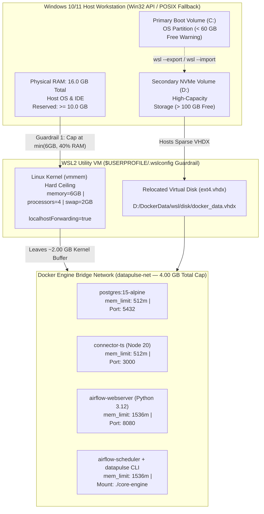

# Runbook 00: Host Hardware Audit, WSL2 Resource Governance & VHDX Storage Relocation

## 1. Purpose & Architectural Scope

This runbook governs **Step 0** of the `data-pulse` platform deployment lifecycle: verifying host workstation hardware capacity, enforcing WSL2 Linux kernel memory and CPU boundaries via `.wslconfig`, and relocating Docker Desktop virtual disks (`ext4.vhdx`) away from constrained primary boot partitions (`C:`).

Running Apache Airflow 2.9 (`webserver` + `scheduler`), PostgreSQL 15, the Python 3.12 Reverse-ETL Core Engine, and the Node.js 20 TypeScript CRM Connector concurrently without hypervisor resource caps causes the WSL2 `vmmem` process to claim up to 50% of physical RAM for Linux page caching and expand sparse VHDX files until the primary OS drive runs out of disk blocks.



---

## 2. Executing the Cross-Platform Pre-Flight Hardware Audit

Before starting Docker Desktop or initializing local DuckDB storage, execute `scripts/preflight_hardware_audit.py` from the repository root (`$REPO_ROOT`).

### 2.1 Execution Command

```bash
python scripts/preflight_hardware_audit.py
```

### 2.2 Expected Sanitized Console Output

```text
========================================================================
[INFO] DATA-PULSE STEP-0 PRE-FLIGHT HARDWARE & WSL2 AUDIT
========================================================================
[OK] Logical CPUs Detected    : 12
[OK] Total Physical RAM       : 15.72 GB
[OK] Available Physical RAM   : 5.51 GB
[OK] Volume C:                : 49.06 GB free / 453.07 GB total (89.2% used)
[OK] Volume D:                : 451.85 GB free / 476.92 GB total (5.3% used)
------------------------------------------------------------------------
[INFO] Recommended WSL2 Memory Cap : 6GB
[INFO] Recommended WSL2 vCPU Cap   : 4
[INFO] Preferred Docker Volume     : D:
[OK] Wrote audit report       : $REPO_ROOT/docs/runbooks/hardware_audit_report.json
[OK] Wrote WSL2 config        : $REPO_ROOT/infra/wsl/.wslconfig.recommended
========================================================================
```

### 2.3 Generated Runtime Artifacts & Zero-Kilometer OPSEC Governance

The audit script generates two local untracked artifacts (both excluded via `.gitignore` to preserve Zero-Kilometer repository hygiene):

1. `$REPO_ROOT/docs/runbooks/hardware_audit_report.json`: Contains hardware telemetry with all host paths sanitized to `$USERPROFILE\.wslconfig` and `$REPO_ROOT/...` so no local OS usernames ever leak into telemetry outputs.
2. `$REPO_ROOT/infra/wsl/.wslconfig.recommended`: Ready-to-deploy WSL2 hypervisor configuration file.

Inspect the generated JSON report using Python or `cat`:

```bash
python -c "import pathlib; print(pathlib.Path('docs/runbooks/hardware_audit_report.json').read_text(encoding='utf-8'))"
```

Expected JSON payload structure:

```json
{
  "recommendations": {
    "notes": [
      "Volume D: has >100GB free; relocate Docker VHDX and DuckDB files to D:.",
      "Cap WSL2 memory via $USERPROFILE\\.wslconfig to prevent vmmem host exhaustion."
    ],
    "preferred_docker_volume": "D:",
    "wsl2_memory_cap_gb": 6,
    "wsl2_processors_cap": 4,
    "wsl2_swap_gb": 2
  },
  "system": {
    "available_ram_gb": 5.51,
    "logical_cpus": 12,
    "os": "Windows",
    "os_release": "11",
    "python_version": "3.12.6",
    "total_ram_gb": 15.72
  },
  "volumes": {
    "C:": {
      "free_gb": 49.06,
      "total_gb": 453.07,
      "used_gb": 404.01,
      "used_pct": 89.2
    },
    "D:": {
      "free_gb": 451.85,
      "total_gb": 476.92,
      "used_gb": 25.07,
      "used_pct": 5.3
    }
  }
}
```

### 2.4 Cross-Platform Fallback Behavior (Windows vs. Linux vs. macOS)

`scripts/preflight_hardware_audit.py` automatically adapts to the host operating system without third-party C extensions (`psutil` is not required):

| Host OS Platform | Physical & Available RAM Detection Mechanism | Disk Volume Enumeration Mechanism | WSL2 `.wslconfig` Applicability |
| :--- | :--- | :--- | :--- |
| **Windows 10/11 (`win32`)** | Win32 `ctypes.windll.kernel32.GlobalMemoryStatusEx` (`MEMORYSTATUSEX` struct) | Scans drives `C:` through `Z:` via `shutil.disk_usage()` | Active — applies directly to `$USERPROFILE\.wslconfig` |
| **Linux (`linux`)** | Parses `/proc/meminfo` (`MemTotal`, `MemAvailable`) with `os.sysconf` fallback | Inspects root mount `/` via `shutil.disk_usage("/")` mapped to key `C:` | Reference only — native Linux Docker uses cgroups v2 (`mem_limit`) directly |
| **macOS (`darwin`)** | POSIX `os.sysconf("SC_PAGE_SIZE") * os.sysconf("SC_PHYS_PAGES")` | Inspects root volume `/` via `shutil.disk_usage("/")` mapped to key `C:` | Reference only — configure memory slider in Docker Desktop / Colima / OrbStack |

---

## 3. Applying `.wslconfig` Resource Limits on Windows Hosts

### 3.1 Generated `.wslconfig.recommended` Specification

```ini
# Auto-generated by scripts/preflight_hardware_audit.py
# Copy this file to %USERPROFILE%\.wslconfig and run: wsl --shutdown
[wsl2]
memory=6GB
processors=4
swap=2GB
localhostForwarding=true
```

### 3.2 Copying `.wslconfig` Without UTF-16LE BOM Corruption

> **[CRITICAL] Encoding Trap:** Never use legacy Windows PowerShell 5.1 `Out-File` or `>` redirection to create `.wslconfig`, as it writes `UTF-16LE` with a Byte Order Mark (BOM) that WSL2 silently ignores! Always copy the UTF-8 file directly or write ASCII/UTF-8 without BOM.

Run the following commands in PowerShell from `$REPO_ROOT`:

```powershell
# 1. Copy the UTF-8 recommended configuration to your Windows user profile root
Copy-Item -Path ".\infra\wsl\.wslconfig.recommended" -Destination "$env:USERPROFILE\.wslconfig" -Force

# 2. Verify file contents and confirm first bytes are ASCII '[wsl2]' (no UTF-16 BOM)
Get-Content "$env:USERPROFILE\.wslconfig"

# 3. Gracefully stop Docker Desktop and shut down the WSL2 hypervisor
wsl --shutdown

# 4. Wait 8 seconds for the vmmem process to terminate completely, then verify inside WSL
wsl -e free -h
```

Expected output from `wsl -e free -h`:

```text
               total        used        free      shared  buff/cache   available
Mem:           5.8Gi       312Mi       5.3Gi       2.0Mi       198Mi       5.3Gi
Swap:          2.0Gi          0B       2.0Gi
```

---

## 4. Relocating Docker Desktop VHDX Storage to Secondary NVMe Volume (`D:`)

When the pre-flight audit reports `Volume C:` has `< 60 GB` free while `Volume D:` has `> 100 GB` free, relocate Docker's virtual disk (`ext4.vhdx`) to `D:\DockerData`.

### 4.1 Method A: Docker Desktop GUI Relocation

1. Open **Docker Desktop** -> **Settings** (gear icon) -> **Resources** -> **Advanced** (or **Disk image location**).
2. Change **Disk image location** from `C:\Users\<username>\AppData\Local\Docker\wsl` to:
   ```text
   D:\DockerData\wsl
   ```
3. Click **Apply & restart**. Docker Desktop automatically moves `docker_data.vhdx` off `C:`.

### 4.2 Method B: Headless PowerShell WSL2 Export/Import Relocation

For headless workstations or manual WSL distribution relocation (`docker-desktop-data`):

```powershell
# 1. Shut down all running WSL2 instances and create the target directory on D:
wsl --shutdown
New-Item -ItemType Directory -Force -Path "D:\DockerData\wsl\distro" | Out-Null
New-Item -ItemType Directory -Force -Path "D:\DockerData\wsl\exports" | Out-Null

# 2. Verify current WSL distributions and states
wsl --list --verbose

# 3. Export docker-desktop-data to a tar archive on D:
wsl --export docker-desktop-data "D:\DockerData\wsl\exports\docker-desktop-data.tar"

# 4. Unregister the old distribution from C: (reclaims C: disk blocks immediately)
wsl --unregister docker-desktop-data

# 5. Re-import docker-desktop-data onto the high-capacity D: NVMe volume (WSL version 2)
wsl --import docker-desktop-data "D:\DockerData\wsl\distro" "D:\DockerData\wsl\exports\docker-desktop-data.tar" --version 2

# 6. Remove temporary export tarball after verifying Docker starts cleanly
Remove-Item "D:\DockerData\wsl\exports\docker-desktop-data.tar" -Force
```

---

## 5. Reclaiming Bloated `ext4.vhdx` Disk Space & Dropping Linux Page Caches

WSL2 virtual disks (`ext4.vhdx`) grow dynamically when container images or DuckDB databases are created, but do not automatically shrink when files are deleted inside Linux (`docker system prune -af`).

### 5.1 Dropping WSL2 Linux Page Caches (Live Without Restart)

If `vmmem` RAM consumption climbs after repeated 10,000-row sync simulations:

```bash
wsl -u root -e sh -c "sync; echo 3 > /proc/sys/vm/drop_caches && free -h"
```

### 5.2 Compacting Sparse VHDX Files on Host Disk

**Option 1: Windows Pro/Enterprise with Hyper-V PowerShell (`Optimize-VHD`)**

```powershell
# Run in an Elevated (Administrator) PowerShell prompt
wsl --shutdown
Optimize-VHD -Path "D:\DockerData\wsl\disk\docker_data.vhdx" -Mode Full
```

**Option 2: Windows Home / Standard via `diskpart` (Works on All Windows Editions)**

```powershell
wsl --shutdown
@"
select vdisk file="D:\DockerData\wsl\disk\docker_data.vhdx"
attach vdisk readonly
compact vdisk
detach vdisk
exit
"@ | diskpart
```

---

## 6. Operational Troubleshooting Table

| Failure Symptom / Error Code | Root Cause Analysis | Diagnostic Verification Command | Definitive Remediation Action |
| :--- | :--- | :--- | :--- |
| **`vmmem` consumes > 8 GB RAM despite `.wslconfig` existing** | `.wslconfig` was saved in `UTF-16LE` with BOM by PowerShell `>`, or `wsl --shutdown` was not executed after editing. | `wsl -e free -h` shows `Mem: 7.8Gi` instead of `5.8Gi`. | Run `Copy-Item .\infra\wsl\.wslconfig.recommended "$env:USERPROFILE\.wslconfig" -Force` and `wsl --shutdown`. |
| **`localhost:3000` or `localhost:8080` connection refused from Windows browser** | WSL2 `localhostForwarding` disabled or Windows HNS (`Host Network Service`) NAT port binding stalled after sleep/hibernation. | `curl -i http://127.0.0.1:3000/health` returns `Connection refused` while container is `Up`. | Confirm `localhostForwarding=true` in `$USERPROFILE\.wslconfig`, run `wsl --shutdown`, and restart Docker Desktop. |
| **`OOMKilled` (`Exit Code 137`) on `airflow-scheduler` or `airflow-webserver`** | Total container allocation exceeded WSL2 VM memory because `memory=` in `.wslconfig` was set `< 5GB`. | `docker inspect datapulse-airflow-scheduler --format "{{.State.OOMKilled}}"` returns `true`. | Set `memory=6GB` and `swap=2GB` in `$USERPROFILE\.wslconfig` so the `4.25GB` stack has `1.75GB` kernel headroom. |
| **`System.IO.IOException: No space left on device` during `docker compose build`** | Primary `C:` partition filled by uncompacted `ext4.vhdx` or dangling Docker buildkit layers. | `python scripts/preflight_hardware_audit.py` shows `Volume C:` `< 5 GB free`. | Run `docker system prune -af --volumes`, relocate VHDX to `D:\DockerData\wsl`, and compact via `Optimize-VHD`. |
| **`pytest tests/test_preflight_audit.py` fails on OPSEC assertion (`CeX` found)** | Manual edit introduced a hardcoded local Windows user path into `hardware_audit_report.json`. | `Select-String -Path docs/runbooks/hardware_audit_report.json -Pattern "Users"` | Re-run `python scripts/preflight_hardware_audit.py` to regenerate sanitized `$USERPROFILE` and `$REPO_ROOT` paths. |
