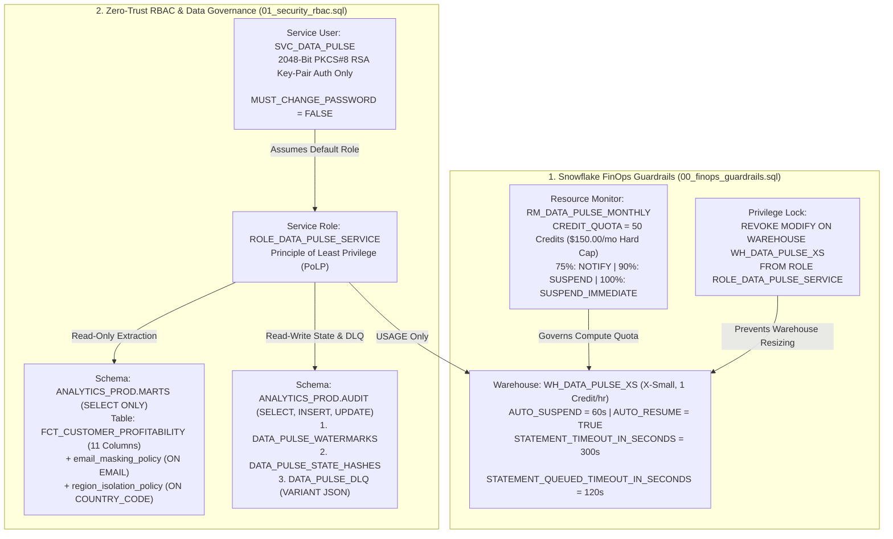

# Runbook 01: Snowflake FinOps Guardrails & Zero-Trust RBAC Provisioning

## 1. Purpose & Architectural Scope

This runbook governs **Step 1** of the `data-pulse` platform: provisioning enterprise Snowflake compute and security infrastructure using strict **FinOps cost ceilings** (`infra/snowflake/00_finops_guardrails.sql`) and **Zero-Trust RBAC / PKCS#8 RSA Key-Pair authentication** (`infra/snowflake/01_security_rbac.sql`).

Every production Reverse-ETL pipeline connecting to Snowflake must enforce two non-negotiable guarantees:
1. **Hard Financial Bounding:** Worst-case runaway query loops cannot exceed `50 credits/month` (`$150.00/mo` at `$3.00/credit`), while normal hourly coalesced operation consumes `~0.8333 credits/month` (`$2.50/mo` or `$30.00/yr`, saving `$4,170.00/yr` against a `$4,200.00/yr` commercial SaaS Reverse-ETL baseline).
2. **Principle of Least Privilege (PoLP):** The headless service identity (`SVC_DATA_PULSE` assuming `ROLE_DATA_PULSE_SERVICE`) authenticates exclusively via 2048-bit RSA key-pair (`MUST_CHANGE_PASSWORD = FALSE`), holds `SELECT`-only access on `ANALYTICS_PROD.MARTS.FCT_CUSTOMER_PROFITABILITY` (governed by Dynamic Data Masking and Row Access Policies), and holds `SELECT, INSERT, UPDATE` only on `ANALYTICS_PROD.AUDIT` state tables (`DATA_PULSE_WATERMARKS`, `DATA_PULSE_STATE_HASHES`, `DATA_PULSE_DLQ`).



---

## 2. Cryptographic PKCS#8 RSA Key-Pair Generation & File Permission Lockdown

Never configure static passwords for `SVC_DATA_PULSE`. Generate a 2048-bit PKCS#8 RSA key pair inside `$REPO_ROOT/infra/keys/` (excluded from Git via `.gitignore`).

### 2.1 Generating Unencrypted or Encrypted PKCS#8 Private Keys

```bash
# Create local key directory (ignored by Git and Docker build context)
mkdir -p infra/keys

# Option A: Generate unencrypted PKCS#8 2048-bit private key (standard for local/container secrets)
openssl genrsa 2048 | openssl pkcs8 -topk8 -inform PEM -out infra/keys/rsa_key.p8 -nocrypt

# Option B: Generate passphrase-encrypted PKCS#8 private key (set SNOWFLAKE_PRIVATE_KEY_PASSPHRASE in .env)
# openssl genrsa 2048 | openssl pkcs8 -topk8 -v2 aes256 -inform PEM -out infra/keys/rsa_key.p8

# Derive the corresponding public key (.pub)
openssl rsa -in infra/keys/rsa_key.p8 -pubout -out infra/keys/rsa_key.pub
```

### 2.2 Locking Down Private Key File Permissions (POSIX & Windows)

**On Linux / macOS / WSL2 (POSIX `0600` Owner-Read-Only):**

```bash
chmod 700 infra/keys
chmod 600 infra/keys/rsa_key.p8
chmod 644 infra/keys/rsa_key.pub
```

**On Windows PowerShell (`icacls` Inheritance Removal & Current-User ACL Lock):**

```powershell
icacls "infra\keys\rsa_key.p8" /inheritance:r
icacls "infra\keys\rsa_key.p8" /grant:r "$($env:USERNAME):(R)"
```

### 2.3 Extracting the Single-Line Public Key Body & SHA-256 Fingerprint

Extract the base64 body of `rsa_key.pub` (stripping `-----BEGIN PUBLIC KEY-----` headers and newlines) for `01_security_rbac.sql`, and compute its `SHA-256` digest to cross-check against Snowflake's `DESC USER SVC_DATA_PULSE`:

```bash
# 1. Print single-line public key string to paste into 01_security_rbac.sql
grep -v "PUBLIC KEY" infra/keys/rsa_key.pub | tr -d '\n\r' && echo ""

# 2. Compute local SHA-256 public key fingerprint (base64 encoded) for verification
openssl rsa -pubin -in infra/keys/rsa_key.pub -outform DER | openssl dgst -sha256 -binary | openssl enc -base64
```

---

## 3. Executing Snowflake FinOps & RBAC DDL Scripts

### 3.1 Step 1A: Execute `infra/snowflake/00_finops_guardrails.sql`

Run via SnowSQL or Snowflake Worksheets as `ACCOUNTADMIN`:

```bash
snowsql -a "$SNOWFLAKE_ACCOUNT" -u "$SNOWFLAKE_ADMIN_USER" -r ACCOUNTADMIN -f infra/snowflake/00_finops_guardrails.sql
```

What `00_finops_guardrails.sql` provisions:
1. **`RM_DATA_PULSE_MONTHLY` Resource Monitor:** `CREDIT_QUOTA = 50` (`$150.00/mo` hard ceiling at `$3.00/credit`), resetting `MONTHLY` on day `1` at `00:00 UTC`, with triggers at `75%` (`NOTIFY`), `90%` (`SUSPEND`), and `100%` (`SUSPEND_IMMEDIATE`).
2. **`WH_DATA_PULSE_XS` Compute Warehouse:** `WAREHOUSE_SIZE = 'XSMALL'`, `AUTO_SUSPEND = 60`, `AUTO_RESUME = TRUE`, `INITIALLY_SUSPENDED = TRUE`, `STATEMENT_TIMEOUT_IN_SECONDS = 300`, `STATEMENT_QUEUED_TIMEOUT_IN_SECONDS = 120`, bound to `RM_DATA_PULSE_MONTHLY`.
3. **Immutable Warehouse Sizing:** Explicitly executes `REVOKE MODIFY ON WAREHOUSE WH_DATA_PULSE_XS FROM ROLE ROLE_DATA_PULSE_SERVICE;` so the service account can never execute `ALTER WAREHOUSE ... SET WAREHOUSE_SIZE = 'XXLARGE'`.

### 3.2 Step 1B: Execute `infra/snowflake/01_security_rbac.sql`

Replace `MIIBIjANBgkqhkiG9w0BAQEFAAOCAQ8AMIIBCgKCAQEA_REPLACE_WITH_REAL_PUB_KEY` in `infra/snowflake/01_security_rbac.sql` with the output from Section 2.3, then execute:

```bash
snowsql -a "$SNOWFLAKE_ACCOUNT" -u "$SNOWFLAKE_ADMIN_USER" -r ACCOUNTADMIN -f infra/snowflake/01_security_rbac.sql
```

What `01_security_rbac.sql` provisions:
1. **Database & Schemas (`SYSADMIN`):** `ANALYTICS_PROD`, `ANALYTICS_PROD.MARTS`, and `ANALYTICS_PROD.AUDIT`.
2. **11-Column Source Mart Table (`ANALYTICS_PROD.MARTS.FCT_CUSTOMER_PROFITABILITY`):**
   - `CUSTOMER_ID VARCHAR(64) PRIMARY KEY`, `EMAIL VARCHAR(255) NOT NULL`, `COMPANY_NAME VARCHAR(255) NOT NULL`, `COUNTRY_CODE VARCHAR(2) NOT NULL`, `CURRENCY_CODE VARCHAR(3) NOT NULL`, `ANNUAL_REVENUE DOUBLE NOT NULL`, `ANNUAL_COST DOUBLE NOT NULL`, `NET_PROFITABILITY_USD DOUBLE NOT NULL`, `PROFIT_MARGIN_PCT DOUBLE NOT NULL`, `CUSTOMER_TIER VARCHAR(32) NOT NULL`, `UPDATED_AT TIMESTAMP_NTZ NOT NULL`.
3. **Three Governance State Tables (`ANALYTICS_PROD.AUDIT`):**
   - `DATA_PULSE_WATERMARKS (SYNC_ID VARCHAR(128) PRIMARY KEY, WATERMARK_TS TIMESTAMP_NTZ, RECORDS_PROCESSED NUMBER, UPDATED_AT TIMESTAMP_NTZ)`
   - `DATA_PULSE_STATE_HASHES (SYNC_ID VARCHAR(128), RECORD_ID VARCHAR(64), PAYLOAD_HASH VARCHAR(64), UPDATED_AT TIMESTAMP_NTZ, PRIMARY KEY (SYNC_ID, RECORD_ID))`
   - `DATA_PULSE_DLQ (SYNC_ID VARCHAR(128), RECORD_ID VARCHAR(64), FAILED_AT TIMESTAMP_NTZ, STAGE VARCHAR(64), ERROR_CODE VARCHAR(64), ERROR_MESSAGE VARCHAR(1024), RAW_PAYLOAD VARIANT, STATUS VARCHAR(32))`
4. **Dynamic Data Masking & Row Access Policies:**
   - `email_masking_policy`: Reveals full `EMAIL` only when `CURRENT_ROLE() IN ('ACCOUNTADMIN', 'ROLE_DATA_PULSE_SERVICE')`; masks all other roles to `'***MASKED***@' || SPLIT_PART(val, '@', 2)`.
   - `region_isolation_policy`: Bound to `COUNTRY_CODE`, isolating regional analyst roles (`ROLE_EU_ANALYST` -> `'DE', 'FR', 'ES', 'IT', 'NL'`) while allowing `ROLE_DATA_PULSE_SERVICE` global sync visibility.

---

## 4. Five Verification SQL Queries & Expected Tabular Outputs

Execute these 5 verification queries in Snowflake after running `00_finops_guardrails.sql` and `01_security_rbac.sql`:

### Query 1: Verify Warehouse Auto-Suspend, Statement Timeouts & Resource Monitor Binding

```sql
SHOW WAREHOUSES LIKE 'WH_DATA_PULSE_XS';
```

Expected Tabular Output:

```text
+------------------+-----------+----------+---------+--------------+-------------------+------------------+-------------------------+
| name             | state     | size     | type    | auto_suspend | auto_resume       | resource_monitor | statement_timeout_in_s  |
+------------------+-----------+----------+---------+--------------+-------------------+------------------+-------------------------+
| WH_DATA_PULSE_XS | SUSPENDED | X-Small  | STANDARD|           60 | true              | RM_DATA_PULSE... |                     300 |
+------------------+-----------+----------+---------+--------------+-------------------+------------------+-------------------------+
```

### Query 2: Verify Resource Monitor Credit Quota (`50 Credits = $150.00/mo Ceiling`)

```sql
SHOW RESOURCE MONITORS LIKE 'RM_DATA_PULSE_MONTHLY';
```

Expected Tabular Output:

```text
+-----------------------+--------------+-------------+-----------+----------+-------------------+------------------------+
| name                  | credit_quota | used_credits| frequency | notify_at| suspend_at        | suspend_immediately_at |
+-----------------------+--------------+-------------+-----------+----------+-------------------+------------------------+
| RM_DATA_PULSE_MONTHLY |        50.00 |        0.00 | MONTHLY   |       75%|               90% |                   100% |
+-----------------------+--------------+-------------+-----------+----------+-------------------+------------------------+
```

### Query 3: Verify Least-Privilege Role Grants (`SELECT` on `MARTS`, `SELECT/INSERT/UPDATE` on `AUDIT`)

```sql
SHOW GRANTS TO ROLE ROLE_DATA_PULSE_SERVICE;
```

Expected Tabular Output:

```text
+-----------+-------------------------------------------------------+------------+-------------------------+
| privilege | name                                                  | granted_on | grantee_name            |
+-----------+-------------------------------------------------------+------------+-------------------------+
| USAGE     | WH_DATA_PULSE_XS                                      | WAREHOUSE  | ROLE_DATA_PULSE_SERVICE |
| USAGE     | ANALYTICS_PROD                                        | DATABASE   | ROLE_DATA_PULSE_SERVICE |
| USAGE     | ANALYTICS_PROD.MARTS                                  | SCHEMA     | ROLE_DATA_PULSE_SERVICE |
| SELECT    | ANALYTICS_PROD.MARTS.FCT_CUSTOMER_PROFITABILITY       | TABLE      | ROLE_DATA_PULSE_SERVICE |
| USAGE     | ANALYTICS_PROD.AUDIT                                  | SCHEMA     | ROLE_DATA_PULSE_SERVICE |
| SELECT    | ANALYTICS_PROD.AUDIT.DATA_PULSE_WATERMARKS            | TABLE      | ROLE_DATA_PULSE_SERVICE |
| INSERT    | ANALYTICS_PROD.AUDIT.DATA_PULSE_WATERMARKS            | TABLE      | ROLE_DATA_PULSE_SERVICE |
| UPDATE    | ANALYTICS_PROD.AUDIT.DATA_PULSE_WATERMARKS            | TABLE      | ROLE_DATA_PULSE_SERVICE |
| SELECT    | ANALYTICS_PROD.AUDIT.DATA_PULSE_STATE_HASHES          | TABLE      | ROLE_DATA_PULSE_SERVICE |
| INSERT    | ANALYTICS_PROD.AUDIT.DATA_PULSE_STATE_HASHES          | TABLE      | ROLE_DATA_PULSE_SERVICE |
| UPDATE    | ANALYTICS_PROD.AUDIT.DATA_PULSE_STATE_HASHES          | TABLE      | ROLE_DATA_PULSE_SERVICE |
| SELECT    | ANALYTICS_PROD.AUDIT.DATA_PULSE_DLQ                   | TABLE      | ROLE_DATA_PULSE_SERVICE |
| INSERT    | ANALYTICS_PROD.AUDIT.DATA_PULSE_DLQ                   | TABLE      | ROLE_DATA_PULSE_SERVICE |
| UPDATE    | ANALYTICS_PROD.AUDIT.DATA_PULSE_DLQ                   | TABLE      | ROLE_DATA_PULSE_SERVICE |
+-----------+-------------------------------------------------------+------------+-------------------------+
```

### Query 4: Verify RSA Public Key Fingerprint on `SVC_DATA_PULSE`

```sql
DESC USER SVC_DATA_PULSE;
```

Expected Tabular Output (confirm `RSA_PUBLIC_KEY_FP` matches `SHA256:<base64>` from Section 2.3):

```text
+--------------------------+------------------------------------------------------+
| property                 | value                                                |
+--------------------------+------------------------------------------------------+
| NAME                     | SVC_DATA_PULSE                                       |
| DEFAULT_ROLE             | ROLE_DATA_PULSE_SERVICE                              |
| DEFAULT_WAREHOUSE        | WH_DATA_PULSE_XS                                     |
| MUST_CHANGE_PASSWORD     | false                                                |
| RSA_PUBLIC_KEY_FP        | SHA256:4k8xP9vLmN2qR7tW1yZ3bC5dF6gH8jK0lM2nP4qR6sT=  |
+--------------------------+------------------------------------------------------+
```

### Query 5: Verify Policy Attachments (`email_masking_policy` & `region_isolation_policy`)

```sql
SELECT POLICY_NAME, POLICY_KIND, REF_COLUMN_NAME, POLICY_STATUS
FROM TABLE(ANALYTICS_PROD.INFORMATION_SCHEMA.POLICY_REFERENCES(
  REF_ENTITY_NAME => 'ANALYTICS_PROD.MARTS.FCT_CUSTOMER_PROFITABILITY',
  REF_ENTITY_DOMAIN => 'TABLE'
));
```

Expected Tabular Output:

```text
+-------------------------+-------------------+-----------------+---------------+
| POLICY_NAME             | POLICY_KIND       | REF_COLUMN_NAME | POLICY_STATUS |
+-------------------------+-------------------+-----------------+---------------+
| EMAIL_MASKING_POLICY    | MASKING_POLICY    | EMAIL           | ACTIVE        |
| REGION_ISOLATION_POLICY | ROW_ACCESS_POLICY | COUNTRY_CODE    | ACTIVE        |
+-------------------------+-------------------+-----------------+---------------+
```

---

## 5. Zero-Downtime 90-Day RSA Key Rotation Procedure (`RSA_PUBLIC_KEY_2`)

Snowflake supports two simultaneous public key slots (`RSA_PUBLIC_KEY` and `RSA_PUBLIC_KEY_2`) on a user object, enabling zero-downtime key rotation every 90 days:

```bash
# 1. Generate the new rotated PKCS#8 key pair
openssl genrsa 2048 | openssl pkcs8 -topk8 -inform PEM -out infra/keys/rsa_key_next.p8 -nocrypt
openssl rsa -in infra/keys/rsa_key_next.p8 -pubout -out infra/keys/rsa_key_next.pub
chmod 600 infra/keys/rsa_key_next.p8
```

```sql
-- 2. Bind the new public key to slot 2 (RSA_PUBLIC_KEY_2) while slot 1 remains active
USE ROLE SECURITYADMIN;
ALTER USER SVC_DATA_PULSE SET RSA_PUBLIC_KEY_2 = '<NEW_PUBLIC_KEY_BASE64>';

-- 3. Update SNOWFLAKE_PRIVATE_KEY_PATH in production secret store to rsa_key_next.p8
-- 4. Verify next hourly sync succeeds using slot 2, then unset old slot 1:
ALTER USER SVC_DATA_PULSE UNSET RSA_PUBLIC_KEY;
```

---

## 6. Operational Troubleshooting Table

| Failure Symptom / Error Code | Root Cause Analysis | Diagnostic Verification Command | Definitive Remediation Action |
| :--- | :--- | :--- | :--- |
| **`250001 (08001): JWT token is invalid` during `SnowflakeWarehouseAdapter` connect** | Public key fingerprint in Snowflake (`RSA_PUBLIC_KEY_FP`) does not match `infra/keys/rsa_key.p8`, or host clock skew exceeds 60 seconds. | Compare `DESC USER SVC_DATA_PULSE;` (`RSA_PUBLIC_KEY_FP`) against `openssl rsa -pubin -in infra/keys/rsa_key.pub -outform DER \| openssl dgst -sha256 -binary \| openssl enc -base64`. | Re-apply `ALTER USER SVC_DATA_PULSE SET RSA_PUBLIC_KEY = '...'` and sync host NTP clock (`w32tm /resync` or `chronyc makestep`). |
| **`ValueError: Private key required for Snowflake connection` in `snowflake_adapter.py`** | Neither `SNOWFLAKE_PRIVATE_KEY_PATH` nor `SNOWFLAKE_PRIVATE_KEY_RAW` is set in `.env`, or the file path does not exist inside the container. | `python -c "import os, pathlib; print(pathlib.Path(os.getenv('SNOWFLAKE_PRIVATE_KEY_PATH', 'infra/keys/rsa_key.p8')).is_file())"` | Generate `infra/keys/rsa_key.p8` per Section 2.1 and ensure `.env` sets `SNOWFLAKE_PRIVATE_KEY_PATH=infra/keys/rsa_key.p8`. |
| **`SQL access control error: Insufficient privileges to operate on table DATA_PULSE_STATE_HASHES`** | `01_security_rbac.sql` was only partially executed or `GRANT SELECT, INSERT, UPDATE ON ALL TABLES IN SCHEMA ANALYTICS_PROD.AUDIT` was skipped. | Run `SHOW GRANTS TO ROLE ROLE_DATA_PULSE_SERVICE;` in Snowflake. | Re-run `infra/snowflake/01_security_rbac.sql` as `ACCOUNTADMIN` / `SECURITYADMIN`. |
| **`Warehouse 'WH_DATA_PULSE_XS' cannot be resumed because resource monitor limit exceeded`** | Monthly credit consumption reached `100%` (`50.0` credits = `$150.00`), triggering `SUSPEND_IMMEDIATE` on `RM_DATA_PULSE_MONTHLY`. | `SHOW RESOURCE MONITORS LIKE 'RM_DATA_PULSE_MONTHLY';` inspects `used_credits`. | Audit `SNOWFLAKE.ACCOUNT_USAGE.QUERY_HISTORY` for ad-hoc queries on `WH_DATA_PULSE_XS`; if legitimate backfill, temporarily raise quota as `ACCOUNTADMIN`. |
| **`TypeError: Password was given but private key is not encrypted` (or vice versa)** | `SNOWFLAKE_PRIVATE_KEY_PASSPHRASE` is set in `.env` while `rsa_key.p8` was generated with `-nocrypt` (or vice versa). | `head -n 1 infra/keys/rsa_key.p8` (`BEGIN PRIVATE KEY` = unencrypted; `BEGIN ENCRYPTED PRIVATE KEY` = encrypted). | Leave `SNOWFLAKE_PRIVATE_KEY_PASSPHRASE=` empty in `.env` when using `-nocrypt`, or populate the passphrase when using `-v2 aes256`. |
