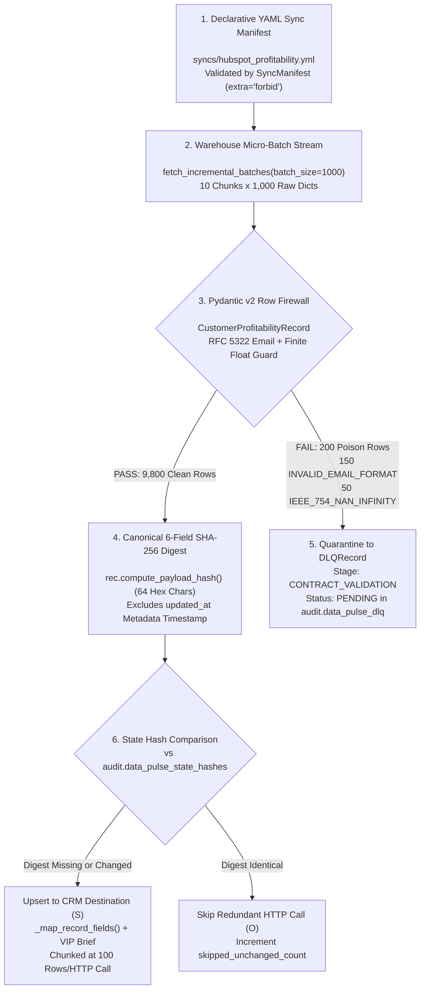

# Runbook 02: Declarative Sync Manifests, Pydantic v2 Data Contracts & SHA-256 Diffing

## 1. Purpose & Architectural Scope

This runbook governs **Step 2** of the `data-pulse` platform: defining Reverse-ETL topologies via declarative YAML manifests (`syncs/hubspot_profitability.yml`), enforcing strict row-level Pydantic v2 domain contracts (`datapulse/domain/models.py`), isolating contract violations into `DLQRecord` envelopes without aborting valid rows, and computing canonical 6-field `SHA-256` payload digests to eliminate redundant downstream CRM API writes.



---

## 2. Annotated Declarative Sync Manifest (`syncs/hubspot_profitability.yml`)

All Reverse-ETL pipelines are declared in `syncs/*.yml` and validated at startup by `load_sync_manifest()` (`core-engine/src/datapulse/infrastructure/manifest_loader.py`). Unknown YAML keys are immediately rejected by Pydantic `ConfigDict(extra="forbid")`.

```yaml
version: "1.0"
sync_id: "hubspot_customer_profitability"
description: "Incremental Reverse-ETL sync of customer profitability metrics from Warehouse Marts to HubSpot CRM v3 Contacts."

source:
  engine_env_var: "SOURCE_ENGINE"
  target_table: "analytics_prod.marts.fct_customer_profitability"
  primary_key: "customer_id"
  watermark_column: "updated_at"
  lookback_window_minutes: 15
  batch_size: 1000

contract:
  model_name: "CustomerProfitabilityRecord"
  strict_mode: true
  reject_nan_infinity: true
  dlq_on_validation_error: true

destination:
  connector: "hubspot_crm_v3"
  endpoint: "/crm/v3/objects/contacts/batch/upsert"
  operation: "batch_upsert"
  id_property: "email"
  rate_limit:
    max_requests: 100
    per_seconds: 10
  field_mapping:
    customer_id: "datapulse_customer_id"
    email: "email"
    company_name: "company"
    country_code: "country"
    currency_code: "datapulse_currency_code"
    annual_revenue: "annualrevenue"
    annual_cost: "datapulse_annual_cost"
    net_profitability_usd: "datapulse_net_profitability_usd"
    profit_margin_pct: "datapulse_profit_margin_pct"
    customer_tier: "datapulse_customer_tier"
```

### 2.1 Validating the Sync Manifest via CLI

Run the following command from `$REPO_ROOT` to validate both the YAML topology and the active warehouse schema:

```bash
python -m datapulse.interfaces.cli validate --manifest syncs/hubspot_profitability.yml
```

Expected Console Output:

```text
[OK] Validated sync manifest 'hubspot_customer_profitability' (source_table=analytics_prod.marts.fct_customer_profitability, destination=hubspot_crm_v3, batch_size=1000).
```

---

## 3. Row-Level Domain Contract Rules (`CustomerProfitabilityRecord`)

Every row extracted from `analytics_prod.marts.fct_customer_profitability` is validated against `CustomerProfitabilityRecord` (`core-engine/src/datapulse/domain/models.py`):

| Domain Field | Python Type | Validation Rules & Invariants | Error Code on Failure |
| :--- | :--- | :--- | :--- |
| `customer_id` | `str` | Non-empty string (`min_length=3`, `max_length=64`), whitespace stripped. | `CONTRACT_VALIDATION_ERROR` |
| `email` | `str` | Normalized to lowercase; must match strict RFC regex `^[A-Za-z0-9._%+-]+@[A-Za-z0-9-]+(\.[A-Za-z0-9-]+)*\.[A-Za-z]{2,}$` and contain no `".."`. | `INVALID_EMAIL_FORMAT` |
| `company_name` | `str` | Non-empty string (`min_length=1`, `max_length=255`). | `CONTRACT_VALIDATION_ERROR` |
| `country_code` | `str` | Normalized to uppercase ISO-3166-1 alpha-2 (`^[A-Z]{2}$`, e.g., `US`, `DE`, `GB`). | `CONTRACT_VALIDATION_ERROR` |
| `currency_code` | `str` | Normalized to uppercase ISO-4217 (`^[A-Z]{3}$`, e.g., `USD`, `EUR`, `GBP`). | `CONTRACT_VALIDATION_ERROR` |
| `annual_revenue` | `float` | Must be finite (`not math.isnan(v) and not math.isinf(v)`). | `IEEE_754_NAN_INFINITY` |
| `annual_cost` | `float` | Must be finite (`not math.isnan(v) and not math.isinf(v)`). | `IEEE_754_NAN_INFINITY` |
| `net_profitability_usd` | `float` | Must be finite (`not math.isnan(v) and not math.isinf(v)`). | `IEEE_754_NAN_INFINITY` |
| `profit_margin_pct` | `float` | Must be finite (`not math.isnan(v) and not math.isinf(v)`). | `IEEE_754_NAN_INFINITY` |
| `customer_tier` | `CustomerTier` | Enum value in `{"ENTERPRISE_VIP", "MID_MARKET", "SMB", "AT_RISK_CHURN"}`. | `CONTRACT_VALIDATION_ERROR` |
| `updated_at` | `datetime` | Valid timestamp (`TIMESTAMP_NTZ` or UTC-aware `datetime`). | `CONTRACT_VALIDATION_ERROR` |

---

## 4. Payload Transformation (`_map_record_fields`) & DLQ Quarantine Payloads

### 4.1 Before & After Field Mapping (`_map_record_fields`)

When a clean warehouse row (`CUST-00001`, an `ENTERPRISE_VIP` account with negative margin `< -12.0%`) passes `CustomerProfitabilityRecord`, `ExecuteSyncUseCase._map_record_fields()` transforms it using `destination.field_mapping` and attaches a deterministic 15–22 word executive brief:

**Input Warehouse Row (`CustomerProfitabilityRecord`):**

```json
{
  "customer_id": "CUST-00001",
  "email": "contact_1@enterprise-00001.io",
  "company_name": "Enterprise Corp 00001",
  "country_code": "US",
  "currency_code": "USD",
  "annual_revenue": 120000.0,
  "annual_cost": 145000.0,
  "net_profitability_usd": -25000.0,
  "profit_margin_pct": -20.83,
  "customer_tier": "ENTERPRISE_VIP",
  "updated_at": "2026-10-29T12:00:00+00:00"
}
```

**Output Mapped HubSpot CRM Properties (`datapulse_*`):**

```json
{
  "datapulse_customer_id": "CUST-00001",
  "email": "contact_1@enterprise-00001.io",
  "company": "Enterprise Corp 00001",
  "country": "US",
  "datapulse_currency_code": "USD",
  "annualrevenue": 120000.0,
  "datapulse_annual_cost": 145000.0,
  "datapulse_net_profitability_usd": -25000.0,
  "datapulse_profit_margin_pct": -20.83,
  "datapulse_customer_tier": "ENTERPRISE_VIP",
  "datapulse_ai_executive_brief": "Action required for Enterprise Corp 00001 (CUST-00001): VIP margin dropped to -20.8% with net USD -25000.00 impact; initiate executive pricing review immediately."
}
```

### 4.2 Sample Quarantined `DLQRecord` JSON Envelopes

When a row fails Pydantic contract validation, `ExecuteSyncUseCase` classifies the failure into a deterministic `error_code` (`INVALID_EMAIL_FORMAT` or `IEEE_754_NAN_INFINITY`), sanitizes non-JSON-compliant `NaN`/`Infinity` floats to string literals via `_sanitize_raw_payload()`, and writes a `DLQRecord` to `audit.data_pulse_dlq`:

**Example 1: `INVALID_EMAIL_FORMAT` (`CUST-09801`..`CUST-09950` — 150 rows)**

```json
{
  "sync_id": "hubspot_customer_profitability",
  "record_id": "CUST-09801",
  "failed_at": "2026-10-29T12:05:00+00:00",
  "stage": "CONTRACT_VALIDATION",
  "error_code": "INVALID_EMAIL_FORMAT",
  "error_message": "1 validation error for CustomerProfitabilityRecord\nemail\n  Value error, Invalid RFC email format: 'corrupt_email_9801@@invalid..domain'",
  "raw_payload": {
    "customer_id": "CUST-09801",
    "email": "corrupt_email_9801@@invalid..domain",
    "company_name": "Enterprise Corp 09801",
    "country_code": "US",
    "currency_code": "USD",
    "annual_revenue": 108010.0,
    "annual_cost": 54005.0,
    "net_profitability_usd": 54005.0,
    "profit_margin_pct": 50.0,
    "customer_tier": "MID_MARKET"
  },
  "status": "PENDING"
}
```

**Example 2: `IEEE_754_NAN_INFINITY` (`CUST-09951`..`CUST-10000` — 50 rows)**

```json
{
  "sync_id": "hubspot_customer_profitability",
  "record_id": "CUST-09951",
  "failed_at": "2026-10-29T12:05:00+00:00",
  "stage": "CONTRACT_VALIDATION",
  "error_code": "IEEE_754_NAN_INFINITY",
  "error_message": "1 validation error for CustomerProfitabilityRecord\nprofit_margin_pct\n  Value error, IEEE-754 NaN/Infinity values are forbidden in financial contracts.",
  "raw_payload": {
    "customer_id": "CUST-09951",
    "email": "contact_9951@enterprise-09951.io",
    "company_name": "Enterprise Corp 09951",
    "annual_revenue": 109510.0,
    "annual_cost": 54755.0,
    "net_profitability_usd": 54755.0,
    "profit_margin_pct": "NaN",
    "customer_tier": "SMB"
  },
  "status": "PENDING"
}
```

---

## 5. Canonical 6-Field `SHA-256` Payload Hash Diffing

Upstream dbt models often perform full-table refreshes that bump `updated_at` across all 10,000 rows even when underlying financial metrics have not changed. To prevent burning 98 HTTP batch calls on unchanged records, `CustomerProfitabilityRecord.compute_payload_hash()` serializes a canonical 6-field projection (sorted keys, compact separators `( ",", ":" )`, rounded to 4 decimal places, **excluding `updated_at`**):

```python
canonical_payload = {
    "customer_id": self.customer_id,
    "email": self.email,
    "annual_revenue": round(self.annual_revenue, 4),
    "annual_cost": round(self.annual_cost, 4),
    "net_profitability_usd": round(self.net_profitability_usd, 4),
    "profit_margin_pct": round(self.profit_margin_pct, 4),
}
```

Verify deterministic hash invariance from the terminal:

```bash
python -m pytest core-engine/tests/test_step2_contracts_and_manifests.py -v
```

Expected Test Output:

```text
core-engine/tests/test_step2_contracts_and_manifests.py::test_valid_customer_record_and_deterministic_sha256_hash_diffing PASSED
core-engine/tests/test_step2_contracts_and_manifests.py::test_reject_ieee754_nan_and_infinity_floats[annual_revenue-nan] PASSED
core-engine/tests/test_step2_contracts_and_manifests.py::test_reject_ieee754_nan_and_infinity_floats[annual_cost-inf] PASSED
core-engine/tests/test_step2_contracts_and_manifests.py::test_reject_ieee754_nan_and_infinity_floats[net_profitability_usd--inf] PASSED
core-engine/tests/test_step2_contracts_and_manifests.py::test_reject_ieee754_nan_and_infinity_floats[profit_margin_pct-nan] PASSED
core-engine/tests/test_step2_contracts_and_manifests.py::test_load_sync_manifest_validates_hubspot_profitability_yaml PASSED
```

---

## 6. Operational Troubleshooting Table

| Failure Symptom / Error Code | Root Cause Analysis | Diagnostic Verification Command | Definitive Remediation Action |
| :--- | :--- | :--- | :--- |
| **`ValidationError: Extra inputs are not permitted` when running `datapulse validate`** | A typo or undocumented YAML key was added to `syncs/hubspot_profitability.yml` (rejected by `ConfigDict(extra="forbid")`). | `python -m datapulse.interfaces.cli validate --manifest syncs/hubspot_profitability.yml` | Compare the YAML keys against `SyncManifest`, `SourceConfig`, `ContractConfig`, and `DestinationConfig` in `models.py`. |
| **`ValueError: SyncManifest mapping must include destination id_property 'email'`** | `destination.field_mapping` in `syncs/hubspot_profitability.yml` does not map any source column to the target `id_property`. | Inspect `destination.id_property` and `destination.field_mapping` in `syncs/hubspot_profitability.yml`. | Ensure `email: "email"` (or the matching `id_property` target value) is present in `field_mapping`. |
| **`Company_name` or `customer_tier` changes in warehouse do not trigger CRM re-upsert** | `compute_payload_hash()` intentionally projects the 6 core identity/financial fields (`customer_id`, `email`, and 4 financial floats). | Inspect `CustomerProfitabilityRecord.compute_payload_hash()` in `core-engine/src/datapulse/domain/models.py`. | If non-financial metadata changes without financial updates, delete the entity's hash row from `audit.data_pulse_state_hashes` or include the column in `canonical_payload`. |
| **`ValueError: Out of range float values are not JSON compliant: nan` during custom DLQ logging** | Calling `json.dumps(..., allow_nan=False)` directly on raw DuckDB rows containing `float('nan')` without `_sanitize_raw_payload()`. | Check traceback in `sync_use_case.py` around `DLQRecord` construction. | Always pass raw failed rows through `ExecuteSyncUseCase._sanitize_raw_payload()` which converts `NaN`/`Infinity` to `"NaN"`/`"Infinity"` strings. |
| **`ValidationError: String should match pattern '^[A-Z]{2}$'` on `country_code`** | Upstream warehouse loaded full country names (`"United States"`) or 3-letter ISO codes (`"USA"`) instead of ISO-3166-1 alpha-2 (`"US"`). | Run `datapulse dlq inspect --sync-id hubspot_customer_profitability`. | Normalize `COUNTRY_CODE` to 2-character ISO alpha-2 in the upstream dbt mart or add a mapping lookup before sync execution. |
