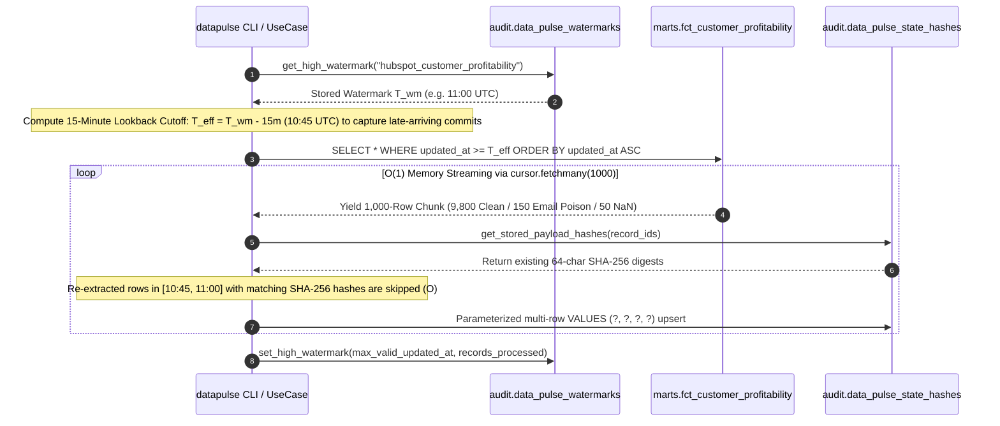

# Runbook 03: Local DuckDB Warehouse Simulation, 10k Chaos Seeding & Incremental Watermarks

## 1. Purpose & Architectural Scope

This runbook governs **Step 3** of the `data-pulse` platform: operating the zero-cost embedded `DuckDBWarehouseAdapter` (`SOURCE_ENGINE=duckdb_local`), executing the deterministic 10,000-row vectorized SQL chaos seeder (`seed_duckdb_warehouse`), verifying incremental watermark advancement with a **15-minute lookback window** (`lookback_window_minutes: 15`), and inspecting all 4 warehouse tables directly from the terminal.



---

## 2. Initializing & Seeding the 10,000-Row Local DuckDB Warehouse

### 2.1 CLI Initialization Command (`datapulse init`)

Run the following command from `$REPO_ROOT` to initialize `data/local_warehouse.duckdb`, create `marts` and `audit` schemas, and deterministically seed 10,000 customer profitability records in `< 0.5 seconds`:

```bash
python -m datapulse.interfaces.cli init --rows 10000 --db-path data/local_warehouse.duckdb
```

Expected Console Output:

```text
[OK] Initialized local warehouse with 10,000 records (clean=9,800, poison_email=150, poison_nan=50, vip_margin_drops=60).
```

### 2.2 Deterministic 10,000-Row Chaos Distribution Specification

`seed_duckdb_warehouse()` (`core-engine/src/datapulse/infrastructure/seeder.py`) uses DuckDB's vectorized `generate_series(1, 10000)` to populate `marts.fct_customer_profitability` with four exact cohorts:

| Record ID Range | Row Count | Customer Tier / Cohort | Injected Chaos / Financial Profile | Expected Sync Outcome |
| :--- | :--- | :--- | :--- | :--- |
| **`CUST-00001` .. `CUST-00060`** | `60` | `ENTERPRISE_VIP` (Executive Alert Cohort) | Clean email & finite floats, but severe negative margin (`-20.83%`, `net_profitability_usd = -25000.00`). | **Upserted (`S`)** + triggers 15–22 word `datapulse_ai_executive_brief`. |
| **`CUST-00061` .. `CUST-09800`** | `9,740` | `ENTERPRISE_VIP`, `MID_MARKET`, `SMB`, `AT_RISK_CHURN` | 100% clean RFC 5322 emails (`contact_i@enterprise-i.io`) and valid positive/moderate margins. | **Upserted (`S`)** in 100-row HTTP batches (`9,800` total valid). |
| **`CUST-09801` .. `CUST-09950`** | `150` | Poison Band A (Malformed RFC Emails) | `email = 'corrupt_email_' || i || '@@invalid..domain'` (double `@` and double `..`). | **Quarantined (`E`)** into `audit.data_pulse_dlq` (`INVALID_EMAIL_FORMAT`). |
| **`CUST-09951` .. `CUST-10000`** | `50` | Poison Band B (IEEE-754 `NaN` Floats) | `profit_margin_pct = CAST('NaN' AS DOUBLE)` (simulates SQL divide-by-zero). | **Quarantined (`E`)** into `audit.data_pulse_dlq` (`IEEE_754_NAN_INFINITY`). |

---

## 3. Five Executable DuckDB Inspection Queries & Expected Outputs

Because DuckDB runs in-process without a background daemon, you can inspect `data/local_warehouse.duckdb` at any time using one-line Python commands from `$REPO_ROOT`:

### Query 1: Verify Total Row Count and 3-Band Chaos Distribution (`9,800 / 150 / 50`)

```bash
python -c "import duckdb; conn = duckdb.connect('data/local_warehouse.duckdb', read_only=True); print(conn.execute('''
SELECT
  COUNT(*) AS total_rows,
  SUM(CASE WHEN customer_id <= 'CUST-09800' THEN 1 ELSE 0 END) AS clean_band_rows,
  SUM(CASE WHEN email LIKE '%@@invalid..domain%' THEN 1 ELSE 0 END) AS poison_email_rows,
  SUM(CASE WHEN isnan(profit_margin_pct) THEN 1 ELSE 0 END) AS poison_nan_rows
FROM marts.fct_customer_profitability;
''').fetchall())"
```

Expected Output:

```text
[(10000, 9800, 150, 50)]
```

### Query 2: Verify the 60 `ENTERPRISE_VIP` Negative-Margin Accounts (`< -12.0%`)

```bash
python -c "import duckdb; conn = duckdb.connect('data/local_warehouse.duckdb', read_only=True); print(conn.execute('''
SELECT COUNT(*) AS vip_negative_margin_count, MIN(profit_margin_pct), MAX(profit_margin_pct)
FROM marts.fct_customer_profitability
WHERE customer_tier = 'ENTERPRISE_VIP' AND NOT isnan(profit_margin_pct) AND profit_margin_pct < -12.0;
''').fetchall())"
```

Expected Output:

```text
[(60, -20.83, -20.83)]
```

### Query 3: Inspect High Watermark State (`audit.data_pulse_watermarks`) After Sync Run

```bash
python -c "import duckdb; conn = duckdb.connect('data/local_warehouse.duckdb', read_only=True); print(conn.execute('''
SELECT sync_id, watermark_ts, records_processed, updated_at
FROM audit.data_pulse_watermarks;
''').fetchall())"
```

Expected Output (after running `datapulse run`):

```text
[('hubspot_customer_profitability', datetime.datetime(2026, 10, 29, 12, 0), 9800, datetime.datetime(2026, 10, 29, 12, 5, 12))]
```

### Query 4: Inspect Stored `SHA-256` Payload Hashes (`audit.data_pulse_state_hashes`)

```bash
python -c "import duckdb; conn = duckdb.connect('data/local_warehouse.duckdb', read_only=True); print(conn.execute('''
SELECT COUNT(*) AS tracked_hashes, MIN(record_id) AS first_id, MAX(record_id) AS last_id
FROM audit.data_pulse_state_hashes
WHERE sync_id = 'hubspot_customer_profitability';
''').fetchall())"
```

Expected Output (`9,800` after initial sync; `10,000` after `datapulse dlq replay`):

```text
[(9800, 'CUST-00001', 'CUST-09800')]
```

### Query 5: Inspect DLQ Breakdown by Error Code and Status (`audit.data_pulse_dlq`)

```bash
python -c "import duckdb; conn = duckdb.connect('data/local_warehouse.duckdb', read_only=True); print(conn.execute('''
SELECT error_code, status, COUNT(*) AS row_count
FROM audit.data_pulse_dlq
GROUP BY error_code, status
ORDER BY error_code;
''').fetchall())"
```

Expected Output (after initial sync: `PENDING`; after `datapulse dlq replay`: `RESOLVED`):

```text
[('IEEE_754_NAN_INFINITY', 'PENDING', 50), ('INVALID_EMAIL_FORMAT', 'PENDING', 150)]
```

---

## 4. Parameterized Batch Upsert Performance & SQL Injection Immunity

In `DuckDBWarehouseAdapter` (`core-engine/src/datapulse/infrastructure/duckdb_adapter.py`):
- **Table & Column Identifier Guards:** `_validate_identifier()` enforces `^[A-Za-z_][A-Za-z0-9_.]*$` before interpolating table or watermark column names into SQL queries.
- **Parameterized Multi-Row `VALUES (?, ?, ?, ?)` Batching:** `upsert_payload_hashes()` and `insert_dlq_records()` construct a single parameterized multi-row `INSERT OR REPLACE INTO ... VALUES (?, ?, ?, ?), ...` statement executed in one DuckDB engine call (`conn.execute(sql, params)`). This guarantees both complete immunity to SQL injection (even if `record_id` contains single quotes like `CUST-'0002`) and sub-second write throughput (`9,800` hashes persisted in `< 0.15s` vs `~180s` if autocommitted row-by-row).

Verify the Step 3 adapter and seeder test suite:

```bash
python -m pytest core-engine/tests/test_step3_adapters_and_seeder.py -v
```

---

## 5. Operational Troubleshooting Table

| Failure Symptom / Error Code | Root Cause Analysis | Diagnostic Verification Command | Definitive Remediation Action |
| :--- | :--- | :--- | :--- |
| **`duckdb.IOException: IO Error: File is already open in ... (PID ...)`** | DuckDB enforces a single-writer process lock on `data/local_warehouse.duckdb`; another Python process, interactive shell, or IDE database viewer holds a write lock. | On Windows: `Get-Process python*`; on Linux/WSL: `lsof data/local_warehouse.duckdb`. | Close the competing Python/IDE connection, or connect read-only (`duckdb.connect(..., read_only=True)`) when running ad-hoc inspection queries. |
| **`duckdb.BinderException` or `SerializationException` on corrupted `.duckdb.wal`** | A previous process was hard-killed (`SIGKILL` / power loss) mid-checkpoint, leaving a truncated Write-Ahead Log (`local_warehouse.duckdb.wal`). | `ls -lh data/local_warehouse.duckdb*` | Remove `data/local_warehouse.duckdb` and `data/local_warehouse.duckdb.wal`, then re-run `python -m datapulse.interfaces.cli init --rows 10000`. |
| **`datapulse run` extracts `10,000` rows again on Run 2 instead of `0` rows** | All seeded rows share `updated_at = CURRENT_TIMESTAMP` inside the **15-minute lookback window** (`T_wm - 15m`), so the watermark query intentionally re-scans recent rows. | Inspect `Skipped Unchanged (O)` and `HTTP Batch Requests` in the console telemetry report. | This is expected design! Even though `10,000` recent rows are scanned inside the 15m lookback window, `SHA-256` hash diffing skips all `10,000` rows (`Upserted (S): 0`, `HTTP Batch Requests: 0`). |
| **`ValueError: Unsafe SQL identifier rejected` during `fetch_incremental_batches`** | `target_table` or `watermark_column` in the YAML manifest contains spaces, semicolons, or SQL comments (`--`). | Run `python -m datapulse.interfaces.cli validate --manifest syncs/hubspot_profitability.yml`. | Restrict `target_table` and `watermark_column` in `syncs/*.yml` to alphanumeric characters, underscores, and schema dots (`analytics_prod.marts.fct_customer_profitability`). |
| **`0` rows extracted on first `datapulse run` when testing production mode** | `datapulse init --no-seed` or `DEMO_SEED_ENABLED=false` was active when the DuckDB file was created, so `marts.fct_customer_profitability` is empty. | `python -c "import duckdb; print(duckdb.connect('data/local_warehouse.duckdb').execute('SELECT COUNT(*) FROM marts.fct_customer_profitability').fetchone())"` | To run the 10k chaos simulation, unset `DEMO_SEED_ENABLED=false` and run `python -m datapulse.interfaces.cli init --rows 10000`. |
