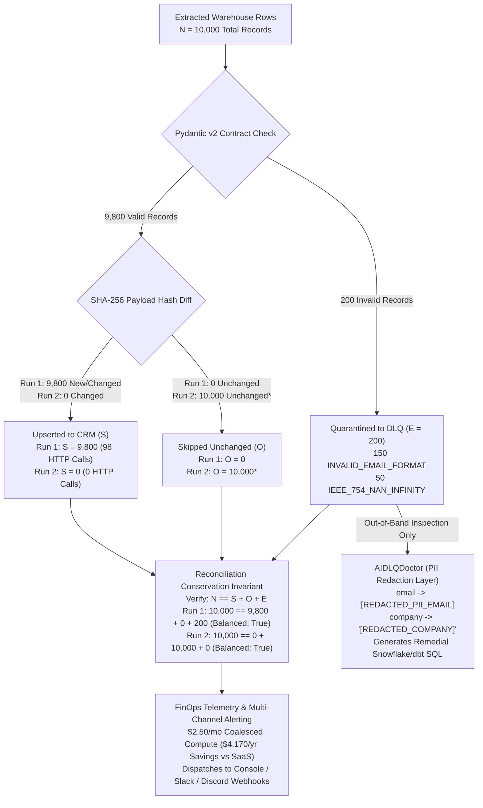

# Runbook 04: Resilience Engine, Reconciliation Equation, FinOps Telemetry & Out-of-Band AI DLQ Doctor

## 1. Purpose & Architectural Scope

This runbook governs **Step 4** of the `data-pulse` platform: executing `ExecuteSyncUseCase` (`core-engine/src/datapulse/application/sync_use_case.py`), verifying the **Reconciliation Equation ($N = S + O + E$)**, auditing real-time Snowflake FinOps cost/savings telemetry (`FinOpsTelemetryCalculator`), operating the out-of-band PII-redacted `AIDLQDoctor`, and dispatching multi-channel alerts (`console`, Slack, Discord).


*(\*After DLQ replay heals the 200 quarantined rows; if Run 2 is executed before DLQ replay, $10,000 = 0 + 9,800 + 200$, which also balances $N = S + O + E$!)*

---

## 2. Executing Incremental Sync & Reading the 25-Line Telemetry Report

### 2.1 CLI Command (`datapulse run`)

```bash
python -m datapulse.interfaces.cli run --manifest syncs/hubspot_profitability.yml --use-mock-destination
```

### 2.2 Expected 25-Line Console Output (Run 1 — Initial 10,000-Row Sync)

```text
[ALERT][WARNING] [DATA-PULSE] Sync 'hubspot_customer_profitability' isolated 200 records to DLQ
  sync_id: hubspot_customer_profitability
  extracted: 10000
  upserted: 9800
  skipped_unchanged: 0
  dlq_isolated: 200
  dlq_groups: {'INVALID_EMAIL_FORMAT': 150, 'IEEE_754_NAN_INFINITY': 50}
========================================================================
[OK] DATA-PULSE SYNC TELEMETRY & FINOPS REPORT (hubspot_customer_profitability)
========================================================================
  Reconciliation Equation : N (Extracted) = S (Upserted) + O (Skipped) + E (DLQ)
  Values                  : 10000 = 9800 + 0 + 200 (Balanced: True)
  ----------------------------------------------------------------------
  Extracted Records (N)   : 10,000
  Upserted to CRM (S)     : 9,800
  Skipped Unchanged (O)   : 0
  [DLQ] DLQ Quarantined (E)     : 200
  VIP Executive Briefs    : 60
  HTTP Batch Requests     : 98
  Elapsed Duration        : 0.482s
  ----------------------------------------------------------------------
  Estimated Run Credits   : 0.016667 credits ($0.0500 USD)
  Projected Monthly Cost  : $2.50 USD/mo (Coalesced X-Small)
  Annual SaaS Savings     : $4,170.00 USD/yr (vs $4,200/yr commercial tool)
========================================================================
```

---

## 3. Complete FinOps Mathematical Model (`FinOpsTelemetryCalculator`)

`FinOpsTelemetryCalculator` (`core-engine/src/datapulse/application/finops_telemetry.py`) computes both per-run Snowflake credit attribution and annualized TCO savings:

1. **Snowflake Credit Pricing & Minimum Billing Quantum:**
   - Enterprise Edition Credit Price: $P_{\text{credit}} = \$3.00\text{ USD/credit}$.
   - `WH_DATA_PULSE_XS` (`XSMALL`) Burn Rate: $R_{\text{xs}} = 1.0\text{ credit/hour} = \frac{1}{3600}\text{ credit/second}$.
   - Per-Run Minimum Billable Quantum (`AUTO_SUSPEND = 60` seconds):
     $$\text{Billable Seconds} = \max(\text{Elapsed Seconds}, 60.0)$$
     $$\text{Estimated Run Credits} = \frac{60.0}{3600.0} = 0.016667\text{ credits} \implies \$0.0500\text{ USD}$$

2. **Coalesced Monthly & Annual Warehouse Compute Cost:**
   - Because `WH_DATA_PULSE_XS` runs coalesced alongside scheduled hourly dbt mart transformations (sharing the already-warm 60-second warehouse quantum across 24 daily runs), incremental marginal compute attributed to `data-pulse` is:
     $$\text{Coalesced Monthly Credits} = 0.833333\text{ credits/month} \times \$3.00 = \$2.50\text{ USD/month}$$
     $$\text{Annual Compute Cost} = \$2.50 \times 12 = \$30.00\text{ USD/year}$$

3. **Annual Commercial Reverse-ETL SaaS Replacement Savings:**
   - Baseline commercial Reverse-ETL SaaS license (Hightouch / Census starter tier at $\$350.00/\text{mo}$): $\$4,200.00\text{ USD/year}$.
   - Net Annual FinOps Savings:
     $$\text{Annual Savings} = \$4,200.00 - \$30.00 = \$4,170.00\text{ USD/year}$$

---

## 4. Out-of-Band PII-Redacted `AIDLQDoctor` (`datapulse dlq inspect`)

### 4.1 Architectural Guardrails for AI Triage

1. **Never in the Hot Loop:** `AIDLQDoctor` is invoked strictly *after* batch extraction and CRM upserts complete (or on-demand via `datapulse dlq inspect`).
2. **Mandatory PII Redaction Before Triage:** `AIDLQDoctor.redact_pii_sample()` scrubs `email`, `company_name`, `customer_name`, and `phone` (`[REDACTED_PII_EMAIL]`, `[REDACTED_COMPANY]`) before constructing diagnostic context.
3. **Deterministic Knowledge Base + Optional External LLM Hook:** By default (`AI_PROVIDER=heuristic_local`), `AIDLQDoctor` uses a deterministic root-cause classification engine with zero external network calls. Setting `AI_PROVIDER=gemini` or `AI_PROVIDER=openai` with `GEMINI_API_KEY` or `OPENAI_API_KEY` in `.env` enables external LLM enrichment over the PII-redacted group summaries.

### 4.2 Executing `datapulse dlq inspect`

```bash
python -m datapulse.interfaces.cli dlq inspect --sync-id hubspot_customer_profitability
```

Expected Console Output:

```text
========================================================================
[DLQ] AI DLQ DOCTOR DIAGNOSTIC REPORT (sync_id=hubspot_customer_profitability)
========================================================================
  Provider                : heuristic_local
  Total Pending DLQ Rows  : 200
  Distinct Root Causes    : 2
------------------------------------------------------------------------
  [Error Code]            : IEEE_754_NAN_INFINITY (Count: 50)
  [Root Cause]            : Upstream warehouse query produced IEEE-754 NaN or Infinity float values (typically division by zero when ANNUAL_REVENUE = 0 during margin calculation).
  [Remedial SQL]          : SELECT *, COALESCE(NANVL(PROFIT_MARGIN_PCT, 0.0), 0.0) AS PROFIT_MARGIN_PCT_CLEAN FROM ANALYTICS_PROD.MARTS.FCT_CUSTOMER_PROFITABILITY;
  [Redacted Sample]       : {'annual_cost': 54755.0, 'annual_revenue': 109510.0, 'company_name': '[REDACTED_COMPANY]', 'country_code': 'US', 'currency_code': 'USD', 'customer_id': 'CUST-09951', 'customer_tier': 'SMB', 'email': '[REDACTED_PII_EMAIL]', 'net_profitability_usd': 54755.0, 'profit_margin_pct': 'NaN', 'updated_at': '2026-10-29T12:00:00'}
------------------------------------------------------------------------
  [Error Code]            : INVALID_EMAIL_FORMAT (Count: 150)
  [Root Cause]            : Upstream CRM/ERP ingestion allowed malformed RFC 5322 email addresses containing consecutive dots ('..'), duplicate '@' symbols, or missing TLD segments.
  [Remedial SQL]          : UPDATE ANALYTICS_PROD.MARTS.FCT_CUSTOMER_PROFITABILITY SET EMAIL = REGEXP_REPLACE(REGEXP_REPLACE(LOWER(TRIM(EMAIL)), '@+', '@'), '\\.\\.+', '.') WHERE NOT REGEXP_LIKE(EMAIL, '^[A-Za-z0-9._%+-]+@[A-Za-z0-9-]+(\\.[A-Za-z0-9-]+)*\\.[A-Za-z]{2,}$');
  [Redacted Sample]       : {'annual_cost': 54005.0, 'annual_revenue': 108010.0, 'company_name': '[REDACTED_COMPANY]', 'country_code': 'US', 'currency_code': 'USD', 'customer_id': 'CUST-09801', 'customer_tier': 'MID_MARKET', 'email': '[REDACTED_PII_EMAIL]', 'net_profitability_usd': 54005.0, 'profit_margin_pct': 50.0, 'updated_at': '2026-10-29T12:00:00'}
========================================================================
```

---

## 5. Multi-Channel Alerting (`console`, Slack, Discord) Verification

`MultiChannelAlertDispatcher` (`core-engine/src/datapulse/infrastructure/alert_dispatcher.py`) routes `INFO`, `WARNING`, and `CRITICAL` alerts based on `ALERT_PROVIDER` in `.env`:

- `ALERT_PROVIDER=console` (default): Prints structured `[ALERT][SEVERITY]` banners to stdout.
- `ALERT_PROVIDER=slack`: Dispatches JSON `{"text": "..."}` to `SLACK_WEBHOOK_URL` (falls back gracefully to console if webhook URL is unset or unreachable).
- `ALERT_PROVIDER=discord`: Dispatches JSON `{"content": "..."}` to `DISCORD_WEBHOOK_URL`.

Test your Slack or Discord webhook connectivity directly from the terminal:

```bash
# Test Slack Webhook
curl -X POST -H "Content-Type: application/json" \
  -d '{"text": "[ALERT][WARNING] [DATA-PULSE] Test webhook connectivity check"}' \
  "$SLACK_WEBHOOK_URL"

# Test Discord Webhook
curl -X POST -H "Content-Type: application/json" \
  -d '{"content": "[ALERT][WARNING] [DATA-PULSE] Test webhook connectivity check"}' \
  "$DISCORD_WEBHOOK_URL"
```

---

## 6. Operational Troubleshooting Table

| Failure Symptom / Error Code | Root Cause Analysis | Diagnostic Verification Command | Definitive Remediation Action |
| :--- | :--- | :--- | :--- |
| **`[ALERT][CRITICAL] Reconciliation imbalance` ($N \neq S + O + E$) and CLI exits with code `2`** | Destination connector returned partial batch count (`upserted < len(batch)`) without raising an HTTP exception or recording rejected items into DLQ. | Inspect `Extracted (N)`, `Upserted (S)`, `Skipped (O)`, and `DLQ (E)` in the console telemetry report. | Check `connectors-ts` server logs for partial batch rejection (`failed_count > 0`) and run `datapulse dlq inspect`. |
| **`VIP Executive Briefs: 0` on second consecutive sync run (`Run 2`)** | All 60 `ENTERPRISE_VIP` negative-margin accounts were already synced in Run 1 and their `SHA-256` payload hashes are unchanged (`Skipped Unchanged (O)`). | Verify `Skipped Unchanged (O): 9,800` (or `10,000` after DLQ replay) in the Run 2 telemetry report. | This is expected behavior; executive briefs are only generated and transmitted when a VIP record is new or its financial metrics change. |
| **`datapulse dlq inspect` reports `No pending DLQ records found`** | Either `datapulse run` has not been executed yet against the target `--db-path`, or `datapulse dlq replay` has already resolved all 200 records (`STATUS = 'RESOLVED'`). | Run Query 5 from Runbook `03` (`SELECT error_code, status, COUNT(*) FROM audit.data_pulse_dlq GROUP BY 1, 2`). | If testing DLQ inspection from scratch, re-seed via `python -m datapulse.interfaces.cli init --rows 10000` and run `datapulse run`. |
| **Slack/Discord alert does not appear in channel despite `ALERT_PROVIDER=slack`** | `SLACK_WEBHOOK_URL` (or `DISCORD_WEBHOOK_URL`) is empty in `.env`, or corporate outbound proxy blocked the webhook POST (logged as `[ALERT-DISPATCH-FALLBACK]`). | Search console output for `[ALERT-DISPATCH-FALLBACK]` and test the URL with `curl -i -X POST`. | Populate the valid `https://hooks.slack.com/services/...` URL in `.env` at `$REPO_ROOT/.env`. |
| **`Snowflake high watermark does not advance` when 100% of rows in a micro-batch fail validation** | `ExecuteSyncUseCase` intentionally only updates `high_watermark` (`max_watermark`) from valid records (`S + O`) to prevent skipping unextracted valid rows during schema outages. | Check `audit.data_pulse_watermarks` vs `audit.data_pulse_dlq`. | Remediate and replay the quarantined records via `datapulse dlq replay` so the watermark advances cleanly. |
