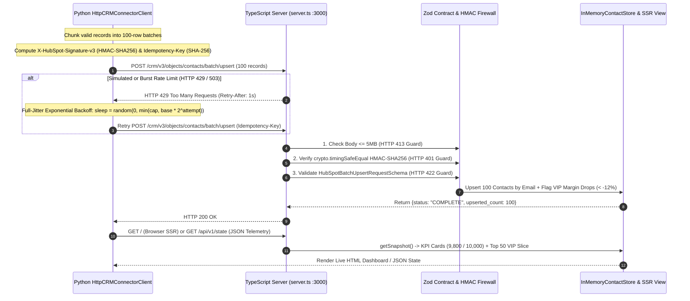

# Runbook 05: TypeScript/Zod CRM Connector Microservice, HMAC Security & Live SSR Dashboard

## 1. Purpose & Architectural Scope

This runbook governs **Step 5** of the `data-pulse` platform: operating the TypeScript/Node.js 20 HubSpot CRM v3 Connector microservice (`connectors-ts/`), verifying runtime **Zod schema validation** (`contracts.ts`), **timing-safe HMAC-SHA256 signature verification** and **5MB payload size limits** (`server.ts`), **Idempotency-Key deduplication**, **AWS-style Full-Jitter Exponential Backoff** (`resilience.ts`), and the **Live SSR Web Dashboard** at `http://localhost:3000`.



---

## 2. Building, Type-Checking, Testing & Starting `connectors-ts`

### 2.1 Installation & Strict Verification Commands

Run the following commands from `$REPO_ROOT`:

```bash
# 1. Install TypeScript & Vitest dependencies cleanly
npm --prefix connectors-ts install

# 2. Run strict TypeScript compiler check (tsc --noEmit, zero errors allowed)
npm --prefix connectors-ts run typecheck

# 3. Execute Vitest unit & resilience test suite (Zod, HMAC, Full-Jitter 429 retry, HTTP endpoints)
npm --prefix connectors-ts test
```

Expected Vitest Console Output:

```text
 RUN  v2.1.4 $REPO_ROOT/connectors-ts

 [PASS] tests/index.test.ts (4)
   [PASS] validates HubSpotBatchUpsertRequestSchema with Zod and rejects invalid emails/batches
   [PASS] retries HTTP 429 rate limits using Full-Jitter Exponential Backoff until 200 OK
   [PASS] verifies timing-safe HMAC-SHA256 signatures and rejects tampered payloads
   [PASS] serves GET /health, POST batch/upsert, GET /api/v1/state, and GET / HTML dashboard

 Test Files  1 passed (1)
      Tests  4 passed (4)
```

### 2.2 Starting the Live HTTP Server on Port `3000`

```bash
npm --prefix connectors-ts start
```

Expected Startup Log:

```text
[OK] DataPulse TypeScript CRM Connector & Live Dashboard listening on http://localhost:3000
```

---

## 3. HTTP Endpoint Reference & Copy-Pasteable `curl` / PowerShell Verification

The TypeScript CRM connector exposes 5 endpoints on `http://localhost:3000`:

| HTTP Method & Route | Purpose | Success Status | Error Statuses |
| :--- | :--- | :--- | :--- |
| `GET /health` | Liveness and readiness probe for Docker Compose & load balancers. | `200 OK` | `404` |
| `GET /` | Live SSR Web Dashboard rendering real-time KPIs and top 50 synced contacts. | `200 OK` (`text/html`) | `500` |
| `GET /api/v1/state` | JSON telemetry snapshot (`total_contacts`, `vip_margin_alerts`, `batches_processed`, 50-contact preview). | `200 OK` (`application/json`) | `500` |
| `POST /api/v1/reset` | Purges all in-memory contacts and resets batch counters to `0` for clean drills/cutover. | `200 OK` (`application/json`) | `500` |
| `POST /crm/v3/objects/contacts/batch/upsert` | HubSpot CRM v3 batch upsert endpoint (`1..100` contacts per request). | `200 OK` (`application/json`) | `400, 401, 413, 422, 429` |

### 3.1 Probe Liveness (`GET /health`) & State (`GET /api/v1/state`)

**Bash / `curl`:**

```bash
curl -s http://localhost:3000/health
curl -s http://localhost:3000/api/v1/state
```

**Windows PowerShell:**

```powershell
Invoke-RestMethod -Uri "http://localhost:3000/health" -Method Get
Invoke-RestMethod -Uri "http://localhost:3000/api/v1/state" -Method Get
```

Expected `GET /health` JSON Response:

```json
{
  "status": "healthy",
  "service": "datapulse-hubspot-connector-ts",
  "total_contacts": 0,
  "batches_processed": 0
}
```

### 3.2 Execute an Authenticated HMAC-SHA256 Batch Upsert (`POST /crm/v3/objects/contacts/batch/upsert`)

Run this self-contained Python one-liner to send a signed 1-contact VIP upsert to `http://localhost:3000`:

```bash
python -c "
import hashlib, hmac, json, time, urllib.request
secret = 'datapulse-local-hmac-secret'
uri = '/crm/v3/objects/contacts/batch/upsert'
ts = str(int(time.time() * 1000))
body = json.dumps({'inputs': [{'id': 'cfo@vip-client.io', 'idProperty': 'email', 'properties': {'datapulse_customer_id': 'CUST-00001', 'email': 'cfo@vip-client.io', 'company': 'VIP Client Corp', 'country': 'US', 'datapulse_currency_code': 'USD', 'annualrevenue': 120000.0, 'datapulse_annual_cost': 145000.0, 'datapulse_net_profitability_usd': -25000.0, 'datapulse_profit_margin_pct': -20.83, 'datapulse_customer_tier': 'ENTERPRISE_VIP', 'datapulse_ai_executive_brief': 'Action required for VIP Client Corp (CUST-00001): VIP margin dropped to -20.8% with net USD -25000.00 impact; initiate executive pricing review immediately.'}}]}, separators=(',', ':'))
sig = hmac.new(secret.encode(), f'POST{uri}{body}{ts}'.encode(), hashlib.sha256).hexdigest()
req = urllib.request.Request(f'http://localhost:3000{uri}', data=body.encode(), headers={'Content-Type': 'application/json', 'X-HubSpot-Request-Timestamp': ts, 'X-HubSpot-Signature-v3': sig}, method='POST')
print(urllib.request.urlopen(req).read().decode())
"
```

Expected JSON Response:

```json
{
  "status": "COMPLETE",
  "upserted_count": 1,
  "failed_count": 0,
  "errors": [],
  "processed_at": "2026-10-29T12:10:00.000Z"
}
```

### 3.3 Simulate `HTTP 429` Rate Limiting & Verify Reset (`POST /api/v1/reset`)

```bash
# 1. Trigger a simulated HTTP 429 rate-limit response with Retry-After header
curl -i -X POST http://localhost:3000/crm/v3/objects/contacts/batch/upsert \
  -H "Content-Type: application/json" \
  -H "X-Simulate-Rate-Limit-429: true" \
  -d '{"inputs":[]}'

# 2. Reset in-memory store back to 0 contacts
curl -s -X POST http://localhost:3000/api/v1/reset
```

Expected `POST /api/v1/reset` JSON Response:

```json
{
  "status": "RESET_COMPLETE",
  "total_contacts": 0,
  "batches_processed": 0
}
```

---

## 4. Security Hardening (`ENFORCE_HMAC=true` & `5MB` Payload Cap) and SSR Table Slicing

1. **Strict HMAC Enforcement (`ENFORCE_HMAC=true`):**
   - By default in local development, if `X-HubSpot-Signature-v3` and `X-HubSpot-Request-Timestamp` headers are present (which `HttpCRMConnectorClient` always sends), `server.ts` validates the signature using `crypto.timingSafeEqual`.
   - Setting `ENFORCE_HMAC=true` in `.env` forces `server.ts` to reject any `POST /crm/v3/objects/contacts/batch/upsert` request that omits the `X-HubSpot-Signature-v3` header with `HTTP 401 INVALID_HMAC_SIGNATURE`.
2. **5MB Request Body Guard (`HTTP 413`):**
   - `readRequestBody()` monitors streaming byte length and immediately destroys sockets exceeding `5,242,880` bytes (`5MB`), returning `HTTP 413 PAYLOAD_TOO_LARGE`.
3. **Why the Live SSR Dashboard Table Renders 50 Rows While KPI Shows `9,800` / `10,000`:**
   - Rendering 10,000 HTML `<tr>` DOM nodes on every browser refresh would bloat the HTML response to ~6MB. `InMemoryContactStore.getSnapshot()` tracks all `10,000` contacts in its `Map<string, ContactRecord>` (reflected accurately in the **Total Synced Contacts** KPI card) while slicing the top `50` records (sorting `ENTERPRISE_VIP` accounts with negative margins `< -12%` to the top of the table) for instant `< 15ms` browser rendering.

---

## 5. Operational Troubleshooting Table

| Failure Symptom / Error Code | Root Cause Analysis | Diagnostic Verification Command | Definitive Remediation Action |
| :--- | :--- | :--- | :--- |
| **`HTTP 401 INVALID_HMAC_SIGNATURE` on batch upsert** | `WEBHOOK_HMAC_SECRET` in the Python environment differs from `WEBHOOK_HMAC_SECRET` in the `connectors-ts` process, or `ENFORCE_HMAC=true` is set and headers were omitted. | Compare `echo $WEBHOOK_HMAC_SECRET` in both terminals or inspect `.env`. | Ensure both processes load the identical `WEBHOOK_HMAC_SECRET` from `.env` (default fallback: `datapulse-local-hmac-secret`). |
| **`HTTP 422 ZOD_SCHEMA_VALIDATION_ERROR` returned to client** | Payload violated `HubSpotBatchUpsertRequestSchema` (e.g., `inputs` array empty or `> 100` items, invalid email, or missing required `datapulse_*` properties). | Inspect the `details` array in the `HTTP 422` JSON response body. | Verify `syncs/hubspot_profitability.yml` `field_mapping` matches `HubSpotContactPropertiesSchema` in `connectors-ts/src/domain/contracts.ts`. |
| **`HTTP 413 PAYLOAD_TOO_LARGE: Request body exceeds 5MB limit`** | Client attempted to send a massive unchunked JSON payload (> 5,242,880 bytes) in a single HTTP request. | Check batch chunking size in client (`HttpCRMConnectorClient` chunks at `100` records/request, ~45KB). | Keep HTTP upsert chunks at `<= 100` records per `POST /crm/v3/objects/contacts/batch/upsert` call. |
| **`Error: listen EADDRINUSE: address already in use :::3000`** | Another Node.js instance or Docker container (`datapulse-connector-ts`) is already bound to TCP port `3000`. | Windows: `netstat -ano \| findstr :3000`; Linux/macOS: `lsof -i :3000`. | Stop the existing process (`docker compose stop connector-ts` or kill the old `node` PID) or set `PORT=3001`. |
| **Browser at `http://localhost:3000` still shows `0` contacts after `datapulse run` in Terminal 2** | `datapulse run` was invoked with `--use-mock-destination` (which routes to Python's `InMemoryMockDestinationConnector` instead of HTTP), or the browser tab was not refreshed (`F5`). | Check Terminal 2 output for `[WARN] Live HTTP connector unreachable` or remove `--use-mock-destination`. | Run `python -m datapulse.interfaces.cli run --manifest syncs/hubspot_profitability.yml` (without `--use-mock-destination`) and press `F5` in the browser. |
