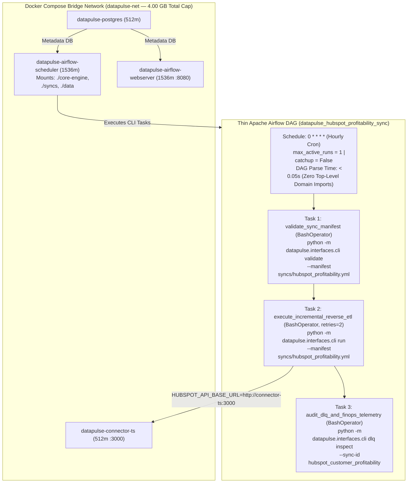

# Runbook 06: Universal `datapulse` CLI, Thin Airflow DAG & Docker Compose Orchestration

## 1. Purpose & Architectural Scope

This runbook governs **Step 6** of the `data-pulse` platform: bootstrapping the Python virtual environment, operating all 5 subcommands of the **Universal `datapulse` CLI** (`core-engine/src/datapulse/interfaces/cli.py`), verifying the **Thin Apache Airflow DAG** (`orchestration/dags/datapulse_hubspot_sync_dag.py`), and managing the 4-container **Docker Compose stack** (`docker-compose.yml`).



---

## 2. Python Virtual Environment Bootstrap & `.env` Auto-Discovery

### 2.1 Creating `.venv` and Installing `data-pulse` in Editable Mode

**On Windows PowerShell:**

```powershell
python -m venv .venv
.\.venv\Scripts\Activate.ps1
python -m pip install --upgrade pip
pip install -e ".[dev]"
# Optional: Install Snowflake cloud adapter extras when connecting to live Snowflake
# pip install -e ".[dev,snowflake]"
```

**On Linux / macOS / WSL2 Bash:**

```bash
python3 -m venv .venv
source .venv/bin/activate
python -m pip install --upgrade pip
pip install -e ".[dev]"
```

### 2.2 Zero-Dependency `.env` Auto-Loader Behavior

At startup, `datapulse.interfaces.cli.main()` invokes `_load_dotenv_if_present()`, which searches the current working directory and `$REPO_ROOT` for a `.env` file and populates `os.environ` via `os.environ.setdefault(key, value)` (never overwriting explicit shell environment variables).

Create your local `.env` from `.env.example`:

```bash
cp .env.example .env
```

---

## 3. Complete `datapulse` CLI Command & Flag Reference Matrix

All CLI commands can be invoked either via the installed entrypoint (`datapulse ...`) or module execution (`python -m datapulse.interfaces.cli ...`):

| Subcommand | Supported CLI Flags | Default Flag Values | Operational Behavior & Exit Codes |
| :--- | :--- | :--- | :--- |
| **`datapulse init`** | `--rows <int>`<br>`--db-path <path>`<br>`--no-seed` | `--rows 10000`<br>`--db-path None` (uses `DUCKDB_DATABASE_PATH`)<br>`--no-seed False` | Creates `marts` & `audit` tables in DuckDB. Seeds `10,000` synthetic chaos records unless `--no-seed` or `DEMO_SEED_ENABLED=false` is set. Returns `0`. |
| **`datapulse validate`** | `--manifest <path>`<br>`--db-path <path>` | `--manifest syncs/hubspot_profitability.yml` | Validates YAML manifest against `SyncManifest` contract and verifies warehouse governance tables exist. Returns `0` on valid, raises on invalid. |
| **`datapulse run`** | `--manifest <path>`<br>`--db-path <path>`<br>`--use-mock-destination`<br>`--no-seed` | `--manifest syncs/hubspot_profitability.yml`<br>`--use-mock-destination False`<br>`--no-seed False` | Runs incremental extraction, Pydantic validation, `SHA-256` hash diffing, CRM batch upserts, and FinOps telemetry. Returns `0` if $N = S + O + E$, or `2` on reconciliation imbalance. |
| **`datapulse dlq inspect`** | `--sync-id <str>`<br>`--db-path <path>` | `--sync-id hubspot_customer_profitability` | Runs out-of-band PII-redacted `AIDLQDoctor` over `PENDING` rows in `audit.data_pulse_dlq`, printing root causes and remedial SQL. Returns `0`. |
| **`datapulse dlq replay`** | `--manifest <path>`<br>`--db-path <path>`<br>`--use-mock-destination`<br>`--no-remediate` | `--manifest syncs/hubspot_profitability.yml`<br>`--use-mock-destination False`<br>`--no-remediate False` | Surgically heals `PENDING` DLQ records (`200` rows), re-validates contracts, upserts to CRM, heals local source rows via `WarehousePort`, and marks DLQ `RESOLVED`. Returns `0` (`1` if any remain pending). |

### 3.1 Copy-Pasteable CLI Walkthrough (Full 5-Step Lifecycle)

```bash
# Step 1: Initialize and seed 10,000 synthetic records in DuckDB
python -m datapulse.interfaces.cli init --rows 10000 --db-path data/local_warehouse.duckdb

# Step 2: Validate declarative YAML manifest
python -m datapulse.interfaces.cli validate --manifest syncs/hubspot_profitability.yml --db-path data/local_warehouse.duckdb

# Step 3: Execute incremental sync (uses live HTTP connector on :3000 if running, or --use-mock-destination)
python -m datapulse.interfaces.cli run --manifest syncs/hubspot_profitability.yml --use-mock-destination --db-path data/local_warehouse.duckdb

# Step 4: Inspect the 200 quarantined DLQ records out-of-band with PII redaction
python -m datapulse.interfaces.cli dlq inspect --sync-id hubspot_customer_profitability --db-path data/local_warehouse.duckdb

# Step 5: Surgically remediate and replay all 200 DLQ records (200 -> 0 pending)
python -m datapulse.interfaces.cli dlq replay --manifest syncs/hubspot_profitability.yml --use-mock-destination --db-path data/local_warehouse.duckdb
```

Expected Output from Step 5 (`dlq replay`):

```text
[OK] DLQ Replay Summary (hubspot_customer_profitability): total_pending=200, remediated_and_synced=200, remaining_pending=0
```

---

## 4. Docker Compose 4-Container Stack Lifecycle & Memory Governance

### 4.1 Container Resource Allocation Table (`docker-compose.yml`)

| Container Name | Service Key | Image / Dockerfile | Hard `mem_limit` | Host Port Mapping | Volume Mounts |
| :--- | :--- | :--- | :--- | :--- | :--- |
| `datapulse-postgres` | `postgres` | `postgres:15-alpine` | `512m` | Internal `:5432` | Ephemeral metadata DB (`airflow`) |
| `datapulse-connector-ts` | `connector-ts` | `infra/docker/Dockerfile.connector` | `512m` | `3000:3000` | None (stateless non-root `node`) |
| `datapulse-airflow-webserver` | `airflow-webserver` | `apache/airflow:2.9.3-python3.12` | `1536m` | `8080:8080` | `./orchestration/dags`, `./core-engine`, `./syncs`, `./data` |
| `datapulse-airflow-scheduler` | `airflow-scheduler` | `apache/airflow:2.9.3-python3.12` | `1536m` | Internal | `./orchestration/dags`, `./core-engine`, `./syncs`, `./data` |
| **Total Stack Footprint** | **4 Services** | **Bridge: `datapulse-net`** | **`4,096 MB` (`4.0 GB`)** | **`:3000`, `:8080`** | **Fits inside `6.0 GB` WSL2 `.wslconfig` cap** |

### 4.2 Starting, Inspecting, Triggering & Tearing Down the Docker Stack

```bash
# 1. Build images and start all 4 containers in detached mode
docker compose up --build -d

# 2. Verify container health status and memory limits
docker compose ps
docker stats --no-stream

# 3. Trigger the Airflow DAG manually inside the scheduler container
docker exec datapulse-airflow-scheduler airflow dags trigger datapulse_hubspot_profitability_sync

# 4. Follow live execution logs from the scheduler and TypeScript CRM connector
docker compose logs -f airflow-scheduler connector-ts

# 5. Tear down all containers, networks, and ephemeral volumes cleanly
docker compose down -v
```

### 4.3 Inspecting Container Environment & Executing Ad-Hoc CLI Commands Inside Docker

You can also invoke any `datapulse` CLI subcommand directly inside the running `datapulse-airflow-scheduler` container:

```bash
# Validate sync manifest inside the running Airflow scheduler container
docker exec datapulse-airflow-scheduler python -m datapulse.interfaces.cli validate --manifest /opt/airflow/syncs/hubspot_profitability.yml

# Run surgical DLQ replay from inside the container against connector-ts:3000
docker exec datapulse-airflow-scheduler python -m datapulse.interfaces.cli dlq replay --manifest /opt/airflow/syncs/hubspot_profitability.yml
```

### 4.4 Verifying the Thin DAG Parse SLA (`< 0.5 Seconds`) Locally

```bash
python -m pytest orchestration/tests/test_step6_cli_and_airflow_dag.py -v
```

Expected Test Output:

```text
orchestration/tests/test_step6_cli_and_airflow_dag.py::test_airflow_thin_dag_parse_sla_and_topology PASSED
orchestration/tests/test_step6_cli_and_airflow_dag.py::test_cli_end_to_end_lifecycle_and_dlq_auto_remediation_replay PASSED
orchestration/tests/test_step6_cli_and_airflow_dag.py::test_step6_docker_adr_and_repo_governance_compliance PASSED
```

---

## 5. Operational Troubleshooting Table

| Failure Symptom / Error Code | Root Cause Analysis | Diagnostic Verification Command | Definitive Remediation Action |
| :--- | :--- | :--- | :--- |
| **`[WARN] Live HTTP connector unreachable at http://localhost:3000; falling back to InMemoryMockDestinationConnector`** | `datapulse run` or `datapulse dlq replay` was invoked without `--use-mock-destination`, and the TypeScript server on `:3000` is not running. | `curl -i http://localhost:3000/health` | Start the TypeScript connector in Terminal 1 (`npm --prefix connectors-ts start`) or pass `--use-mock-destination` for offline CLI runs. |
| **`ModuleNotFoundError: No module named 'datapulse'` inside Airflow container or host shell** | On host: `pip install -e ".[dev]"` was not run; in Docker: `./core-engine` volume mount or `PYTHONPATH=/opt/airflow/core-engine/src` was omitted. | `docker exec datapulse-airflow-scheduler python -c "import datapulse; print(datapulse.__file__)"` | On host run `pip install -e ".[dev]"`; in Docker ensure `docker-compose.yml` mounts `./core-engine:/opt/airflow/core-engine:ro` and sets `PYTHONPATH`. |
| **Airflow task `execute_incremental_reverse_etl` fails to connect to `localhost:3000` inside Docker** | Inside Docker Compose (`datapulse-net`), `localhost` refers to the Airflow container itself, not the `connector-ts` container. | `docker exec datapulse-airflow-scheduler env \| grep HUBSPOT_API_BASE_URL` | Ensure `docker-compose.yml` sets `HUBSPOT_API_BASE_URL: http://connector-ts:3000` on both Airflow services (already configured in `docker-compose.yml`). |
| **`datapulse dlq replay` exits with code `1` (`remaining_pending > 0`)** | `--no-remediate` was passed while the raw payloads in `audit.data_pulse_dlq` still contain unhealed emails (`@@`) or `NaN` floats. | `python -m datapulse.interfaces.cli dlq inspect --sync-id hubspot_customer_profitability` | Omit `--no-remediate` to enable surgical auto-remediation, or fix the upstream records in the warehouse before replaying. |
| **`airflow-webserver` healthcheck stays `starting` for > 60 seconds on first boot** | `airflow db migrate` and `airflow users create` run sequentially on container startup before Gunicorn binds port `8080`. | `docker compose logs airflow-webserver` | Wait ~45–60 seconds for `airflow db migrate` to finish; once `[OK] Listening at: http://0.0.0.0:8080` appears, log in with `admin` / `admin`. |
