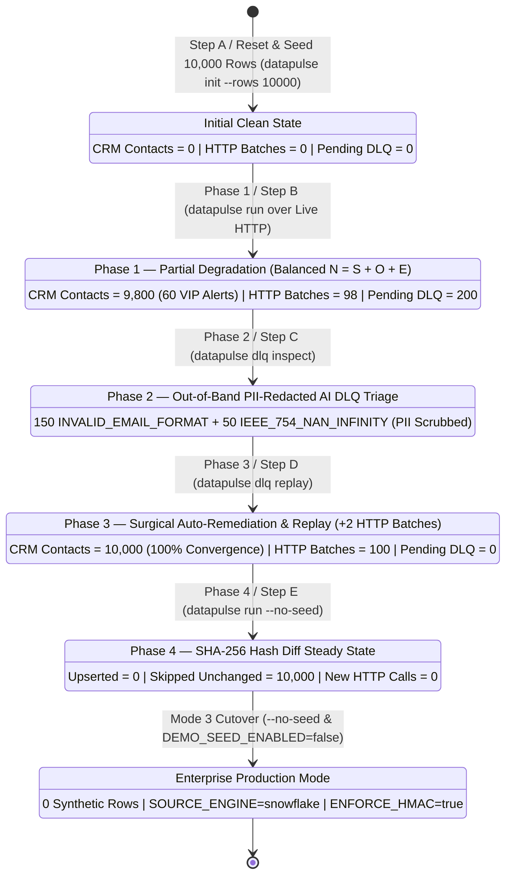

# Runbook 07: Live Production Incident Drill (3 Operational Modes) & Enterprise Cutover Protocol

## 1. Purpose & Architectural Scope

This runbook governs **Step 7** of the `data-pulse` platform. It is designed so any Senior Data Engineer or SRE can execute and verify the complete **10,000-row cross-language chaos incident drill** and subsequently **deactivate synthetic seeding for real production cutover** without reading source code.

It documents three distinct operational modes:
- **PART A / SECTION 1 (Mode 1 — Automated 1-Command 4-Phase Drill):** Runs `python scripts/live_incident_drill.py`, which automatically spawns the Node.js HTTP connector on an ephemeral port, executes all 4 phases over live HTTP, and cleans up after itself.
- **PART A / SECTION 2 (Mode 2 — Interactive 2-Terminal + Live Web Dashboard `http://localhost:3000` Walkthrough):** Step-by-step operator walkthrough (**Steps A, B, C, D, and E**) using **Terminal 1** (`connectors-ts`), **Terminal 2** (`datapulse` CLI), and a live web browser watching contacts climb from `0 -> 9,800 -> 10,000` and pending DLQ drop from `200 -> 0`.
- **PART B / SECTION 3 (Mode 3 — Enterprise Production Cutover & Simulation Deactivation Protocol):** Step-by-step procedure to purge all 10,000 synthetic records, reset the connector (`POST /api/v1/reset`), enforce `--no-seed` and `DEMO_SEED_ENABLED=false`, and cut over to production Snowflake (`SOURCE_ENGINE=snowflake`).



---

## PART A / SECTION 1: Mode 1 — Automated 1-Command 4-Phase Incident Drill

Use **Mode 1** when you want an automated, self-contained verification of the entire Python-to-TypeScript architecture in `< 5 seconds` (used by CI Gate 3 and pre-deployment smoke checks).

### 1.1 Prerequisite Check

Ensure Node.js dependencies are installed in `connectors-ts` and Python dependencies are installed in your environment:

```bash
npm --prefix connectors-ts install
pip install -e ".[dev]"
```

### 1.2 Execute the Automated 1-Command Drill

```bash
python scripts/live_incident_drill.py
```

### 1.3 How `scripts/live_incident_drill.py` Works Under the Hood

1. Allocates a free loopback TCP port (`_find_free_port()`, e.g., `127.0.0.1:54321`) so it never collides with an existing service on `:3000`.
2. Spawns `./node_modules/.bin/tsx src/infrastructure/server.ts` as a child process and polls `GET /health` until `HTTP 200 OK`.
3. Creates an isolated temporary DuckDB database (`data/incident_drill_live.duckdb`), runs all 4 phases over real HTTP with HMAC-SHA256 signing, verifies every assertion, terminates the Node.js subprocess, and deletes the temporary DuckDB files in its `finally:` block.

### 1.4 Expected Console Output (`python scripts/live_incident_drill.py`)

```text
========================================================================
[DRILL] STARTING 4-PHASE LIVE CROSS-LANGUAGE PRODUCTION INCIDENT DRILL
========================================================================
[OK] TypeScript CRM Connector online at http://127.0.0.1:54321/health
[PHASE 1] Seeded 10,000 rows -> Upserted=9800, DLQ=200, Balanced=True
[PHASE 2] AI DLQ Doctor isolated 2 root causes: INVALID_EMAIL_FORMAT=150, IEEE_754_NAN_INFINITY=50
[PHASE 3] Surgical DLQ Replay -> Remediated=200, Remaining_DLQ=0, Total_CRM_Contacts=10000
[PHASE 4] Idempotent Run 2 -> Upserted=0, Skipped_Unchanged=10000, HTTP_Calls=0
========================================================================
[OK] ALL 4 PHASES OF LIVE INCIDENT DRILL PASSED SUCCESSFULLY
========================================================================
```

---

## PART A / SECTION 2: Mode 2 — Interactive 2-Terminal + Live Web Dashboard (`http://localhost:3000`) Walkthrough

Use **Mode 2** when demonstrating the platform live to stakeholders, auditing the UI in a browser, or training SRE operators on manual incident triage and recovery.

### 2.1 Operator State Verification Table Across Steps A -> E

Keep this table open as your ground-truth scorecard while executing Steps A through E below:

| Drill Step | Operator Action Executed | Browser KPI: Total Synced Contacts | Browser KPI: VIP Margin Alerts | Browser KPI: HTTP Batches Processed | DuckDB `PENDING` DLQ Rows | DuckDB `RESOLVED` DLQ Rows | DuckDB Tracked `SHA-256` Hashes |
| :--- | :--- | :---: | :---: | :---: | :---: | :---: | :---: |
| **Step A** | Start Terminal 1 (`:3000`), reset state, & run `datapulse init --rows 10000` in Terminal 2 | **`0`** | **`0`** | **`0`** | **`0`** | **`0`** | **`0`** |
| **Step B** | Run `datapulse run` (Initial 10k Sync over live HTTP) | **`9,800`** | **`60`** | **`98`** | **`200`** | **`0`** | **`9,800`** |
| **Step C** | Run `datapulse dlq inspect` (Out-of-Band AI DLQ Doctor) | **`9,800`** | **`60`** | **`98`** | **`200`** (`150` email, `50` NaN) | **`0`** | **`9,800`** |
| **Step D** | Run `datapulse dlq replay` (Surgical Auto-Remediation & Replay) | **`10,000`** | **`60`** | **`100`** (`+2` batches) | **`0`** | **`200`** | **`10,000`** |
| **Step E** | Run `datapulse run --no-seed` (Idempotent 2nd Sync Run) | **`10,000`** | **`60`** | **`100`** (`+0` batches) | **`0`** | **`200`** | **`10,000`** (`10,000` skipped) |

---

### 2.2 Step-by-Step Interactive Walkthrough (Terminal 1 + Terminal 2 + Web Browser)

#### Step A: Start the Live CRM Server (Terminal 1), Open the Browser (`:3000`), and Seed 10,000 Rows (Terminal 2)

**In Terminal 1 (Keep Running in Foreground):**

```bash
cd connectors-ts
npm install
npm start
```

Expected Terminal 1 Output:

```text
[OK] DataPulse TypeScript CRM Connector & Live Dashboard listening on http://localhost:3000
```

**In Your Web Browser:**
- Navigate to `http://localhost:3000`.
- Observe the initial dashboard state:
  - **Total Synced Contacts:** `0`
  - **VIP Margin Alerts (< -12%):** `0`
  - **HTTP Batches Processed:** `0`
  - **Contact Table:** `"No contacts synced yet. Run the Python DataPulse Sync Engine to populate CRM state."`

**In Terminal 2 (From `$REPO_ROOT`):**

```bash
# Ensure clean starting state in both Connector memory and local DuckDB file
curl -s -X POST http://localhost:3000/api/v1/reset
python -c "import pathlib; [p.unlink(missing_ok=True) for p in pathlib.Path('data').glob('local_warehouse.duckdb*')]"

# Initialize and seed the 10,000-row chaos dataset
python -m datapulse.interfaces.cli init --rows 10000 --db-path data/local_warehouse.duckdb
```

Expected Terminal 2 Output:

```text
{"status":"RESET_COMPLETE","total_contacts":0,"batches_processed":0}
[OK] Initialized local warehouse with 10,000 records (clean=9,800, poison_email=150, poison_nan=50, vip_margin_drops=60).
```

---

#### Step B: Trigger Initial 10,000-Row Sync (`9,800` Synced over HTTP, `200` Quarantined to DLQ)

> **[IMPORTANT] Do NOT pass `--use-mock-destination` in Mode 2!** Omitting `--use-mock-destination` instructs `datapulse` to send real HMAC-signed HTTP batches to `http://localhost:3000`.

**In Terminal 2:**

```bash
python -m datapulse.interfaces.cli run --manifest syncs/hubspot_profitability.yml --db-path data/local_warehouse.duckdb
```

Expected Terminal 2 Output:

```text
[ALERT][WARNING] [DATA-PULSE] Sync 'hubspot_customer_profitability' isolated 200 records to DLQ
  sync_id: hubspot_customer_profitability
  extracted: 10000
  upserted: 9800
  skipped_unchanged: 0
  dlq_isolated: 200
  dlq_groups: {'INVALID_EMAIL_FORMAT': 150, 'IEEE_754_NAN_INFINITY': 50}
========================================================================
[OK] DATA-PULSE SYNC TELEMETRY & FINOPS REPORT (hubspot_customer_profitability)
========================================================================
  Reconciliation Equation : N (Extracted) = S (Upserted) + O (Skipped) + E (DLQ)
  Values                  : 10000 = 9800 + 0 + 200 (Balanced: True)
  ----------------------------------------------------------------------
  Extracted Records (N)   : 10,000
  Upserted to CRM (S)     : 9,800
  Skipped Unchanged (O)   : 0
  [DLQ] DLQ Quarantined (E)     : 200
  VIP Executive Briefs    : 60
  HTTP Batch Requests     : 98
```

**Verify in Web Browser (`http://localhost:3000` — Press `F5` / Refresh) or via `curl`:**
- Because the dashboard is server-side rendered (SSR) for zero client-side bundle overhead, **press `F5` (Refresh)** in your browser tab (or click the **Refresh Telemetry** button):
  - **Total Synced Contacts:** `9,800`
  - **VIP Margin Alerts (< -12%):** `60`
  - **HTTP Batches Processed:** `98`
  - **Contact Table:** Displays the top 50 records (`CUST-00001`..`CUST-00050`), each highlighted with its red `ENTERPRISE_VIP` negative margin (`-20.8%`) and 15–22 word AI Executive Brief.
- Or verify via JSON API in Terminal 2:
  ```bash
  curl -s http://localhost:3000/api/v1/state | python -c "import sys, json; d=json.load(sys.stdin); print({k: d[k] for k in ('total_contacts', 'vip_margin_alerts', 'batches_processed')})"
  ```
  Output: `{'total_contacts': 9800, 'vip_margin_alerts': 60, 'batches_processed': 98}`

---

#### Step C: Out-of-Band AI DLQ Doctor Inspection (`150` Invalid Emails + `50` `NaN` Floats)

**In Terminal 2:**

```bash
python -m datapulse.interfaces.cli dlq inspect --sync-id hubspot_customer_profitability --db-path data/local_warehouse.duckdb
```

Expected Terminal 2 Output:
- Reports `Total Pending DLQ Rows : 200` and `Distinct Root Causes : 2`:
  - `IEEE_754_NAN_INFINITY (Count: 50)` with `COALESCE(NANVL(PROFIT_MARGIN_PCT, 0.0), 0.0)` remedial SQL.
  - `INVALID_EMAIL_FORMAT (Count: 150)` with `REGEXP_REPLACE` remedial SQL.
  - Both sample payloads show `'email': '[REDACTED_PII_EMAIL]'` and `'company_name': '[REDACTED_COMPANY]'`.

---

#### Step D: Surgical DLQ Auto-Remediation & Live HTTP Replay (`9,800 -> 10,000` Contacts, `200 -> 0` DLQ)

**In Terminal 2:**

```bash
python -m datapulse.interfaces.cli dlq replay --manifest syncs/hubspot_profitability.yml --db-path data/local_warehouse.duckdb
```

Expected Terminal 2 Output:

```text
[OK] DLQ Replay Summary (hubspot_customer_profitability): total_pending=200, remediated_and_synced=200, remaining_pending=0
```

**Verify in Web Browser (`http://localhost:3000` — Press `F5` / Refresh) or via `curl`:**
- Press `F5` in your browser at `http://localhost:3000`:
  - **Total Synced Contacts:** `10,000` (all 200 healed records `CUST-09801`..`CUST-10000` are now synced!)
  - **VIP Margin Alerts (< -12%):** `60`
  - **HTTP Batches Processed:** `100` (only `2` incremental HTTP requests were sent for the `200` replayed rows!)
- Verify via JSON API in Terminal 2:
  ```bash
  curl -s http://localhost:3000/api/v1/state | python -c "import sys, json; d=json.load(sys.stdin); print({k: d[k] for k in ('total_contacts', 'vip_margin_alerts', 'batches_processed')})"
  ```
  Output: `{'total_contacts': 10000, 'vip_margin_alerts': 60, 'batches_processed': 100}`

---

#### Step E: Idempotent Second Sync Run (`SHA-256` Hash Diffing -> `0` HTTP Requests)

Now execute `datapulse run --no-seed` a second time to prove that because `datapulse dlq replay` healed both the CRM state and the local DuckDB source rows (and stored all `10,000` `SHA-256` hashes in `audit.data_pulse_state_hashes`), the engine performs **zero HTTP requests** and **zero DLQ quarantines**:

**In Terminal 2:**

```bash
python -m datapulse.interfaces.cli run --manifest syncs/hubspot_profitability.yml --no-seed --db-path data/local_warehouse.duckdb
```

Expected Terminal 2 Output:

```text
========================================================================
[OK] DATA-PULSE SYNC TELEMETRY & FINOPS REPORT (hubspot_customer_profitability)
========================================================================
  Reconciliation Equation : N (Extracted) = S (Upserted) + O (Skipped) + E (DLQ)
  Values                  : 10000 = 0 + 10000 + 0 (Balanced: True)
  ----------------------------------------------------------------------
  Extracted Records (N)   : 10,000
  Upserted to CRM (S)     : 0
  Skipped Unchanged (O)   : 10,000
  [DLQ] DLQ Quarantined (E)     : 0
  VIP Executive Briefs    : 0
  HTTP Batch Requests     : 0
```

Press `F5` in your browser at `http://localhost:3000`: **Total Synced Contacts** remains `10,000` and **HTTP Batches Processed** remains `100` (`+0` requests).

---

## PART B / SECTION 3: Mode 3 — Enterprise Production Cutover & Simulation Deactivation Protocol

When transitioning from the 10,000-row chaos simulation to real customer data in production, follow this exact 5-step cutover checklist to guarantee **zero synthetic records** (`CUST-00001`..`CUST-10000`) exist in your warehouse or CRM.

### Step 1: Purge All Local Simulation DuckDB Files & Reset Connector Memory

```bash
# 1. Remove local DuckDB simulation database and WAL files
python -c "import pathlib; [p.unlink(missing_ok=True) for p in pathlib.Path('data').glob('*.duckdb*')]"

# 2. If the local TypeScript CRM connector is running, reset its in-memory store to 0
curl -s -X POST http://localhost:3000/api/v1/reset
```

### Step 2: Lock Out Synthetic Seeding in `.env` (`DEMO_SEED_ENABLED=false`)

Update `$REPO_ROOT/.env` with your production environment settings:

```ini
# Disable synthetic 10,000-row chaos seeding globally
DEMO_SEED_ENABLED=false

# Select warehouse engine:
# - Use 'snowflake' for enterprise cloud production (requires infra/keys/rsa_key.p8)
# - Or 'duckdb_local' with --no-seed for clean local production staging
SOURCE_ENGINE=snowflake
SNOWFLAKE_ACCOUNT=xy12345.eu-central-1
SNOWFLAKE_USER=SVC_DATA_PULSE
SNOWFLAKE_ROLE=ROLE_DATA_PULSE_SERVICE
SNOWFLAKE_WAREHOUSE=WH_DATA_PULSE_XS
SNOWFLAKE_DATABASE=ANALYTICS_PROD
SNOWFLAKE_SCHEMA=MARTS
SNOWFLAKE_PRIVATE_KEY_PATH=infra/keys/rsa_key.p8

# Enforce mandatory HMAC-SHA256 signature verification on the connector
ENFORCE_HMAC=true
WEBHOOK_HMAC_SECRET=<64_HEX_CHAR_PRODUCTION_HMAC_SECRET>
HUBSPOT_API_BASE_URL=https://api.hubapi.com
```

### Step 3: Initialize Clean Governance Tables with `--no-seed`

Even if testing locally with `SOURCE_ENGINE=duckdb_local`, passing `--no-seed` (or setting `DEMO_SEED_ENABLED=false`) initializes the `marts` and `audit` schemas with **0 synthetic rows**:

```bash
python -m datapulse.interfaces.cli init --no-seed --db-path data/prod_warehouse.duckdb
```

Expected Console Output:

```text
[OK] Initialized clean production warehouse schemas (0 synthetic records seeded).
```

### Step 4: Verify `0` Synthetic Rows via SQL Inspection

```bash
python -c "import duckdb; conn = duckdb.connect('data/prod_warehouse.duckdb', read_only=True); print('Row count:', conn.execute('SELECT COUNT(*) FROM marts.fct_customer_profitability').fetchone()[0])"
```

Expected Output:

```text
Row count: 0
```

### Step 5: Execute Production Sync with `--no-seed`

```bash
python -m datapulse.interfaces.cli run --manifest syncs/hubspot_profitability.yml --no-seed --db-path data/prod_warehouse.duckdb
```

---

## 4. Operational Troubleshooting Table

| Failure Symptom / Error Code | Root Cause Analysis | Diagnostic Verification Command | Definitive Remediation Action |
| :--- | :--- | :--- | :--- |
| **`RuntimeError: Could not find tsx binary` when running `python scripts/live_incident_drill.py`** | `npm install` has not been executed inside `connectors-ts/`, so `connectors-ts/node_modules/.bin/tsx` is missing. | `ls connectors-ts/node_modules/.bin/tsx*` | Run `npm --prefix connectors-ts install` from `$REPO_ROOT`, then re-run `python scripts/live_incident_drill.py`. |
| **Terminal 2 prints `[WARN] Live HTTP connector unreachable at http://localhost:3000; falling back to InMemoryMockDestinationConnector`** | Terminal 1 (`npm --prefix connectors-ts start`) was not started or was stopped (`Ctrl+C`) before running `datapulse run` in Mode 2. | `curl -i http://localhost:3000/health` | Start `npm --prefix connectors-ts start` in Terminal 1, reset DuckDB (`datapulse init --rows 10000`), and re-run Step B. |
| **In Mode 2 Step E, `datapulse run` without `--no-seed` re-injects `200` poison rows (`DLQ Quarantined: 200`)** | Without `--no-seed` (or `DEMO_SEED_ENABLED=false`), `DuckDBWarehouseAdapter(auto_seed=True)` re-runs `seed_duckdb_warehouse()`, overwriting the 200 healed rows in `marts.fct_customer_profitability`. | Inspect `DLQ Quarantined (E)` in Step E output. | Always pass `--no-seed` on Step E (`datapulse run --manifest ... --no-seed`) or set `DEMO_SEED_ENABLED=false` after initial seeding! |
| **Browser at `http://localhost:3000` still shows `9,800` contacts after running `datapulse dlq replay`** | `datapulse dlq replay` was mistakenly invoked with `--use-mock-destination`, or the browser tab was not refreshed (`F5`). | Run `curl -s http://localhost:3000/api/v1/state` to check `total_contacts`. | Re-run `datapulse dlq replay` without `--use-mock-destination` and press `F5` in the browser. |
| **`HTTPBatchesProcessed` in browser is `> 100` during Mode 2 walkthrough** | Previous test runs were executed against `:3000` without resetting the in-memory store (`POST /api/v1/reset`). | `curl -s http://localhost:3000/api/v1/state` | Run `curl -s -X POST http://localhost:3000/api/v1/reset` at the start of Step A before running Step B. |
