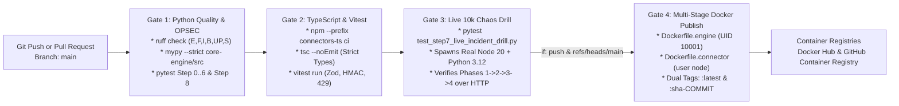

# Runbook 08: 4-Gate CI/CD Pipeline, Zero-Kilometer OPSEC & Immutable Container Publishing

## 1. Purpose & Architectural Scope

This runbook governs **Step 8** of the `data-pulse` platform: operating the **4-Gate GitHub Actions CI/CD Quality Pipeline** (`.github/workflows/ci-quality-gates.yml`), enforcing **Zero-Kilometer Repository Hygiene & OPSEC** (`tests/test_step8_cicd_and_docs_completeness.py`), building and running the multi-stage non-root Docker images (`Dockerfile.engine` and `Dockerfile.connector`), and executing deterministic container rollbacks using immutable `:sha-<git_commit>` tags.



---

## 2. Running All 4 CI Quality Gates Locally Before `git push`

Never push unverified commits to `main`. Run the complete 4-Gate verification sequence locally from `$REPO_ROOT`:

### 2.1 Copy-Pasteable Pre-Push Verification Commands (Bash & PowerShell)

```bash
# GATE 1A: Ruff Linter & Security Rules (E, F, I, B, UP, S — zero warnings allowed)
python -m ruff check core-engine/src core-engine/tests orchestration tests scripts

# GATE 1B: Mypy Strict Static Type Verification
python -m mypy --strict core-engine/src

# GATE 1C: Python Unit, FinOps SQL, Clean Architecture & Zero-Km OPSEC Test Suite
python -m pytest tests/test_preflight_audit.py tests/test_step1_foundation.py core-engine/tests orchestration/tests tests/test_step8_cicd_and_docs_completeness.py -v

# GATE 2: TypeScript Strict Compiler Check & Vitest Unit Suite
npm --prefix connectors-ts run typecheck
npm --prefix connectors-ts test

# GATE 3: Full 4-Phase Live Cross-Language HTTP Chaos Drill
python -m pytest tests/test_step7_live_incident_drill.py -v
```

### 2.2 Expected Full Test Suite Summary Output

```text
======================== 38 passed in 11.84s ========================
```

---

## 3. Multi-Stage Non-Root Docker Builds & `.dockerignore` Hygiene

### 3.1 `.dockerignore` Build Context Isolation

`$REPO_ROOT/.dockerignore` prevents local virtual environments (`.venv`), `node_modules`, `.git` history, local `.env` secrets, and `.duckdb` simulation databases from ever being copied into Docker build contexts or baked into published image layers.

### 3.2 Building Both Production Images Locally (`Gate 4` Verification)

```bash
# Build Python 3.12 Reverse-ETL Core Engine image (runs as non-root UID 10001 'datapulse')
docker build -f infra/docker/Dockerfile.engine -t datapulse/data-pulse-engine:latest .

# Build TypeScript/Node 20 CRM Connector image (runs as non-root user 'node')
docker build -f infra/docker/Dockerfile.connector -t datapulse/data-pulse-connector:latest .
```

Verify image sizes and non-root execution identities:

```bash
docker run --rm --entrypoint id datapulse/data-pulse-engine:latest
docker run --rm --entrypoint id datapulse/data-pulse-connector:latest
```

Expected Output:

```text
uid=10001(datapulse) gid=10001(datapulse) groups=10001(datapulse)
uid=1000(node) gid=1000(node) groups=1000(node)
```

---

## 4. Running Pre-Built Containers Across a Bridge Network & Persistent Volume

When running the pre-built Docker images directly via `docker run` (without `docker compose`) on any Windows, macOS, or Linux host, create a dedicated bridge network (`datapulse-net`) and a named persistent volume (`datapulse-data`) so `init`, `run`, `dlq inspect`, and `dlq replay` share the DuckDB warehouse state and reach `connector-ts` over HTTP:

```bash
# 1. Create isolated Docker bridge network and persistent volume for DuckDB state
docker network create datapulse-net
docker volume create datapulse-data

# 2. Start the TypeScript CRM Connector & Live Dashboard on port 3000
docker run -d --name connector-ts \
  --network datapulse-net \
  -p 3000:3000 \
  -e PORT=3000 \
  -e WEBHOOK_HMAC_SECRET=datapulse-local-hmac-secret \
  datapulse/data-pulse-connector:latest

# 3. Seed 10,000 records into the shared persistent volume
docker run --rm \
  --network datapulse-net \
  -v datapulse-data:/app/data \
  datapulse/data-pulse-engine:latest \
  init --rows 10000 --db-path /app/data/local_warehouse.duckdb

# 4. Run the initial 10,000-row sync over the Docker bridge network to connector-ts:3000
docker run --rm \
  --network datapulse-net \
  -v datapulse-data:/app/data \
  -e HUBSPOT_API_BASE_URL=http://connector-ts:3000 \
  -e WEBHOOK_HMAC_SECRET=datapulse-local-hmac-secret \
  datapulse/data-pulse-engine:latest \
  run --manifest syncs/hubspot_profitability.yml --db-path /app/data/local_warehouse.duckdb

# 5. Surgically remediate and replay all 200 quarantined DLQ rows over HTTP
docker run --rm \
  --network datapulse-net \
  -v datapulse-data:/app/data \
  -e HUBSPOT_API_BASE_URL=http://connector-ts:3000 \
  -e WEBHOOK_HMAC_SECRET=datapulse-local-hmac-secret \
  datapulse/data-pulse-engine:latest \
  dlq replay --manifest syncs/hubspot_profitability.yml --db-path /app/data/local_warehouse.duckdb

# 6. Verify 10,000 synced contacts on the host at http://localhost:3000/api/v1/state
curl -s http://localhost:3000/api/v1/state

# 7. Clean up standalone containers, network, and volume when finished
docker rm -f connector-ts
docker volume rm datapulse-data
docker network rm datapulse-net
```

---

## 5. Configuring GitHub Actions Secrets & Deterministic `:sha-<commit>` Rollback

### 5.1 Required Repository Secrets for Gate 4 Publishing

In GitHub (`Settings` -> `Secrets and variables` -> `Actions`), configure:
- `DOCKERHUB_USERNAME`: Your Docker Hub account username.
- `DOCKERHUB_TOKEN`: A Docker Hub Personal Access Token (PAT) with `Read & Write` scope (never use your raw account password).
- *Note:* If `DOCKERHUB_USERNAME` or `DOCKERHUB_TOKEN` is not configured in a fork, Gate 4 still builds and verifies both multi-stage Docker images on every push to `main` and gracefully skips the remote registry push step.

### 5.2 Deterministic Production Rollback Using `:sha-<commit>` Tags

Every merge to `main` publishes both `:latest` and `:sha-<7_char_commit>` (e.g., `datapulse/data-pulse-engine:sha-a1b2c3d`). If a newly deployed release exhibits regressions, roll back immediately by pinning the previous known-good commit SHA tag:

```bash
export ROLLBACK_SHA="sha-a1b2c3d"
docker pull "datapulse/data-pulse-engine:${ROLLBACK_SHA}"
docker pull "datapulse/data-pulse-connector:${ROLLBACK_SHA}"
```

---

## 6. Operational Troubleshooting Table

| Failure Symptom / Error Code | Root Cause Analysis | Diagnostic Verification Command | Definitive Remediation Action |
| :--- | :--- | :--- | :--- |
| **Gate 1 fails on `ruff check` with `S105` / `S106` (hardcoded password warning)** | A test fixture or variable name containing `secret` or `password` was added without `# noqa: S105` when holding a non-sensitive dummy test constant. | `python -m ruff check core-engine/src tests` | Load real secrets exclusively via `os.getenv()`; for dummy test constants, use clearly non-secret names or explicit `# noqa: S105`. |
| **Gate 1 fails on `test_zero_kilometer_git_hygiene_and_opsec` (`Personal path leaked` or tracked artifact)** | A local runtime file (`hardware_audit_report.json`, `.wslconfig.recommended`, `AUDIT-REPORT.md`) was staged in Git, or a personal host path was written into docs. | `git ls-files` and `python -m pytest tests/test_step8_cicd_and_docs_completeness.py -v` | Run `git rm --cached -f <file>` and replace any personal host path with `$REPO_ROOT` or `$USERPROFILE`. |
| **Gate 1 fails on `File ... exceeds 250-line cap`** | A source code file (`.py`, `.ts`, `.sql`, `.yml`, `Dockerfile*`) grew beyond the strict `250`-line architectural ceiling, or an ADR exceeded `30` lines. | `python -m pytest tests/test_step1_foundation.py -v` | Refactor the source module into cohesive Clean Architecture helpers so every source file remains `<= 250` lines and every ADR remains `20..30` lines. |
| **`docker run datapulse/data-pulse-engine:latest run` loses DuckDB state between commands** | Each `docker run --rm` invocation creates an isolated ephemeral container filesystem unless `-v datapulse-data:/app/data` is mounted. | `docker volume ls` | Always mount `-v datapulse-data:/app/data` (or `-v "$PWD/data:/app/data"`) when running stateful DuckDB commands across separate `docker run` invocations. |
| **`permission denied while trying to open /app/data/local_warehouse.duckdb` in container** | Host bind-mounted directory (`-v ./data:/app/data`) on Linux is owned by `root:root` with `0755`, blocking UID `10001` (`datapulse`). | `ls -ld data/` | Use a Docker named volume (`-v datapulse-data:/app/data`) or grant write permissions on the host directory (`chmod 777 data` or `chown 10001:10001 data`). |
